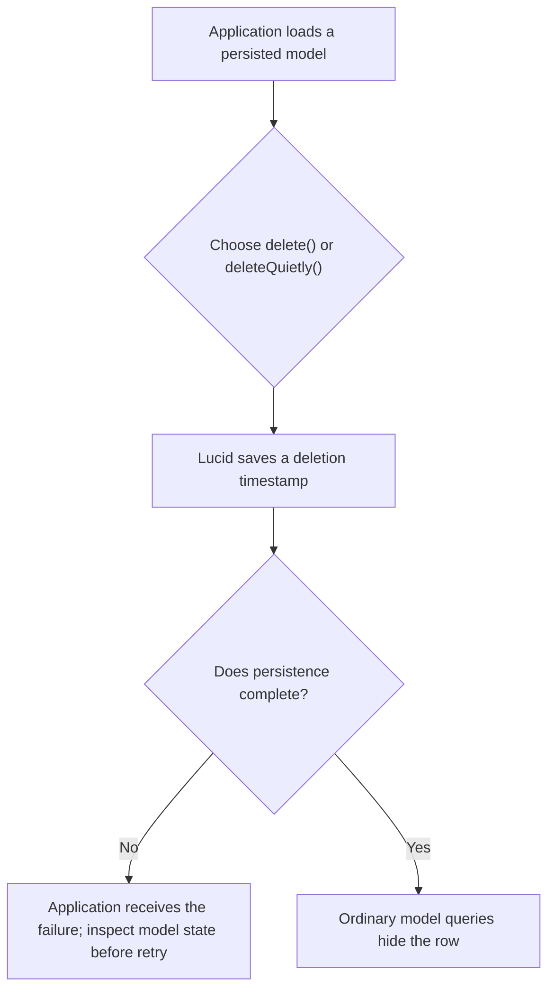
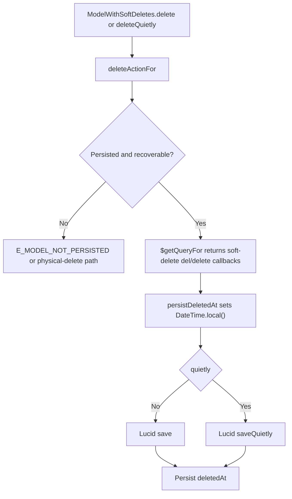

# User story format and maintenance guide

Copy the complete example below into a stable story path such as `user-stories/models/US-MODEL-01-delete-a-model.md`. Its `../../` source links are relative to that copied story path. Replace its sample content with source-backed facts; keep this guide self-contained when copied to another repository.

A story records one meaningful action and why it matters. Use actual roles, entry controls, API or command names, and current source behavior. Keep product contracts in the authoritative decision record, instructions in guides, and runnable scenarios in tests.

## Story example

````markdown
# US-MODEL-01 — Soft-delete a model instance

As an application service, I want to soft-delete a persisted model so that ordinary model queries hide it while the row remains recoverable.

**Status:** Current; source-reviewed availability, not runtime-tested.
**Access:** Application code using a model composed with `SoftDeletes`; application authorization is host-owned.
**Entry:** Instance `delete()` or `deleteQuietly()`.
**Documentation:** [Instance lifecycle reference](../../docs/reference/README.md#instance-lifecycle-methods).
**Source:** [SoftDeletes mixin](../../src/mixin.ts).
**Coverage:** [Model lifecycle tests](../../tests/model.spec.ts).

## Acceptance criteria

- `delete()` saves a deletion timestamp through Lucid's ordinary save hooks; `deleteQuietly()` uses `saveQuietly()`.
- After deletion the model is marked not deleted in memory, while its stored `deletedAt` marks it as trashed; ordinary model fetches omit it.
- Unsaved models are refused. A failed save restores the prior in-memory timestamp only if Lucid has not advanced the model's saved originals.

## User flow



## Code flow

Scope: model instance through Lucid save; route access and application authorization are outside this package.



**Code references:** [SoftDeletes mixin](../../src/mixin.ts), [model lifecycle tests](../../tests/model.spec.ts), [lifecycle reference](../../docs/reference/README.md#instance-lifecycle-methods).
````

## Actions without input fields

For actions without form input, use concise controls and observable results instead of an empty field table. For example:

```markdown
## Acceptance criteria

- **Today** returns the timeline to the start of the current week in the configured time zone.
```

Use real visible controls and behavior. Include confirmation controls and relevant cancellation, refusal, and failure outcomes when they affect the action.

## Writing and maintenance rules

- Use one story per meaningful outcome. Create and edit are distinct when their outcomes differ; inseparable controls may share a story.
- Include every relevant field, including conditional and read-only fields. Record exact labels, controls, required or optional state, defaults, limits, choices, dependencies, visibility and read-only conditions. Describe dynamic choices by their source and filtering rules.
- Link an identical shared field list when useful and describe create/edit differences locally. Do not force readers to reconstruct a form from several links.
- Keep criteria concise and observable. Do not turn them into a test script or duplicate detailed backend contracts.
- Include **Status**, **Access**, **Entry**, **Documentation** and **Source**. Say when no relevant guide exists. Add optional **Coverage** only when a useful test link exists; a link does not say the test ran.
- Keep identifiers and filenames stable. Use the next unused identifier in an area. Retain historical intent with an explicit availability status unless retirement is authorized.
- Maintain the README index, REFERENCE, COVERAGE and GAPS with the stories. “New” means newly catalogued, not newly implemented.
- Compare source behavior with accepted decisions. Record actual mismatches in GAPS without silently changing either intent or code. Do not invent a target when none exists.

## Availability definitions

| Status   | Meaning                                                                 |
| -------- | ----------------------------------------------------------------------- |
| Current  | Exposed under the stated role, configuration and conditions             |
| Hidden   | Implementation remains but its ordinary entry or trigger is unavailable |
| Removed  | Historical capability has no current product entry                      |
| Demo     | Available only in a specified demo context                              |
| Operator | Installation, hosting or recovery outside an ordinary application UI    |
| Planned  | Agreed target without an ordinary implemented journey                   |

Read Status with Access and Entry. A configured switch is an availability condition, not proof of removal. Current is source-reviewed availability, never a test-pass status.

## Diagram and verification conventions

- Every story has a plain-language **User flow** and an implementation **Code flow**, each in a Mermaid flowchart. Include meaningful choices, cancellation, refusal, failure and recovery.
- Trace actual entry, handler, state/service, persistence where applicable and visible result. Use existing symbols; link files under **Code references**. Name the boundary if a flow stops before the final consumer.
- Trace producers as well as consumers. A retained component or setter does not prove a reachable journey. Trace authorization to its owning layer when claiming an access restriction.
- Distinguish server writes, device preferences and read-only operations. Inspect the demo's real persistence path rather than assuming it is mocked.
- For Hidden, Removed or Planned journeys, label the user flow unavailable and show the missing entry/trigger plus any retained support in Code flow.
- Parse every changed diagram and inspect a representative rendering. Syntax validity does not prove behavior or establish that a journey was exercised.
- Verify unique IDs, source/guide links, index and matrix parity, dispositions for old stories, story metadata, gaps, symbols and availability. Report source review separately from runtime results.
