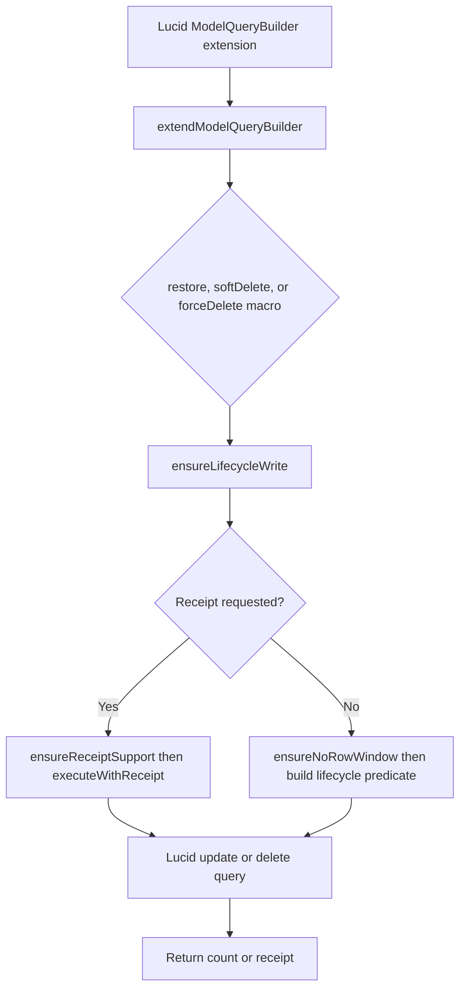

# US-APP-05 — Change lifecycle state for matching rows in bulk

As an application developer, I want to soft-delete, restore, or permanently remove a selected batch with Lucid builders so that many matching rows can change state in one query.

**Status:** Current; source-reviewed API behavior, not runtime-tested here.
**Access:** Application code; the package does not supply authorization, retention, or cascade policy.
**Entry:** `softDelete()`, `restore()`, or `forceDelete()` on a model query builder.
**Documentation:** [Builder lifecycle methods](../../docs/reference/README.md#builder-lifecycle-methods).
**Source:** [Query builder extensions](../../src/bindings/model_query_builder.ts).
**Coverage:** [Builder lifecycle tests](../../tests/builder_lifecycle.spec.ts), [restore tests](../../tests/builder_restore.spec.ts).

## Acceptance criteria

- `extendModelQueryBuilder()` installs these macros. Each validates the model with `ensureLifecycleWrite()`; missing mixin or mapped column rejects with `E_MODEL_SOFT_DELETE`.
- `softDelete()` adds an active-row `whereNull` predicate and updates `deletedAt`; in `onlyTrashed()` mode it changes zero rows. `restore()` restricts to rows with non-null `deletedAt` and sets it to null.
- `forceDelete()` physically deletes matching rows; in `onlyTrashed()` mode it retains a non-null deletion predicate, while other modes keep caller predicates grouped.
- Builder `delete()` and `del()` are Lucid physical deletes in every read mode. Call `softDelete()` for recoverable bulk deletion.
- Without a receipt, methods return the affected row count and reject row-windowed queries. Receipt options require a caller-owned transaction; the package does not open, commit or roll back it.
- `restore()`, `softDelete()` and `forceDelete()` reject many-to-many and has-many-through relation builders before writing. Select related IDs and issue a normal related-model query.
- Builder writes do not hydrate instances, run model hooks, update `updatedAt`, or invoke custom column `prepare` functions.

## User flow

```mermaid
flowchart TD
    A["Application selects rows with a Lucid query"] --> B{"Choose lifecycle action"}
    B -->|Recoverable delete| C["Call softDelete()"]
    B -->|Restore| D["Call restore()"]
    B -->|Permanent removal| E["Call forceDelete()"]
    B -->|delete() or del()| F["Lucid physically deletes matches"]
    C --> G["Matching active rows receive deletedAt"]
    D --> H["Matching trashed rows receive null deletedAt"]
    E --> I["Matching rows are physically removed"]
```

## Code flow

Scope: package builder macros through Lucid query execution; authorization and caller-owned transaction lifecycle are outside this boundary.



**Code references:** [macros and validation](../../src/bindings/model_query_builder.ts), [receipt implementation](../../src/receipts.ts), [lifecycle tests](../../tests/builder_lifecycle.spec.ts), [operation contract](../../docs/reference/README.md#builder-lifecycle-methods).
