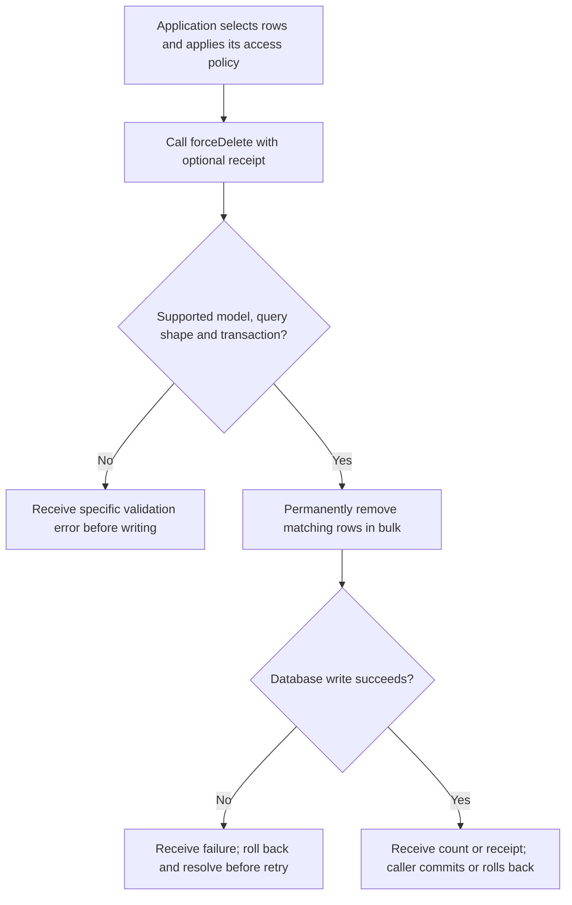
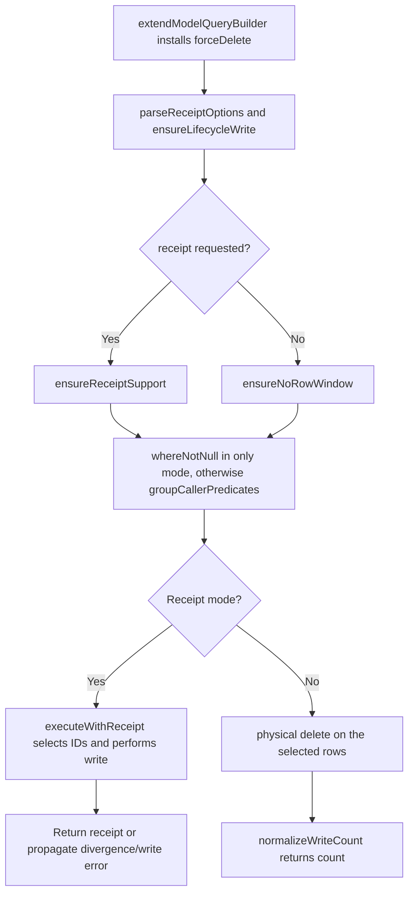

# US-APP-07 — Permanently remove matching rows in bulk

As application code, I want to permanently remove matching rows in bulk so that application retention policy can physically erase a selected set of rows.

**Status:** Current; source-reviewed API availability, not runtime-tested here.
**Access:** Application code using a `SoftDeletes` model; authorization and transaction lifecycle are caller-owned.
**Entry:** A Lucid model query builder followed by `forceDelete(options?)`.
**Documentation:** [Builder lifecycle reference](../../docs/reference/README.md#builder-lifecycle-methods).
**Source:** [extendModelQueryBuilder](../../src/bindings/model_query_builder.ts), [receipt implementation](../../src/receipts.ts).
**Coverage:** [Builder lifecycle tests](../../tests/builder_lifecycle.spec.ts), [builder restore tests (row-window refusals)](../../tests/builder_restore.spec.ts), [receipt tests](../../tests/builder_receipts.spec.ts).

## Acceptance criteria

- The caller selects rows with ordinary Lucid predicates and optionally supplies `{ receipt: true }`; omitted/false returns a count. Unknown option keys or a non-boolean receipt flag reject.
- In `onlyTrashed()` mode it retains the non-null deletion predicate; otherwise it groups caller predicates and can delete active or trashed matches. This is irreversible at the package layer.
- The model must use `SoftDeletes` and have a mapped `deletedAt` column. Many-to-many and has-many-through relation builders reject before writing; query the related model by selected IDs instead.
- Application authorization, tenant predicates and cascade policy are host-owned. Builder writes do not hydrate instances, run model hooks, update `updatedAt` or invoke custom column `prepare` functions.
- Default output is an affected-row count. `{ receipt: true }` instead returns changed primary-key `ids` and `count`; it requires an explicit caller-owned transaction on a supported dialect, a supported query shape and no row window. A divergence raises `E_BULK_RECEIPT_DIVERGED`; roll back the transaction. A receipt describes an uncommitted mutation, not an audit log.
- Without receipts, `limit`, `offset` and relation `groupLimit` are refused; the single-related-row limit for has-one/belongs-to queries is allowed. Database errors propagate. The caller owns commit or rollback.
- Builder `delete()` and `del()` physically delete regardless of read mode; they do not provide recoverable deletion or the lifecycle methods' selection guarantees.

## User flow

## Code flow

Scope: provider-installed builder macro through Lucid execution; route authorization and outer transaction ownership remain with the host.

**Code references:** [Macro and validation](../../src/bindings/model_query_builder.ts), [executeWithReceipt and option parsing](../../src/receipts.ts), [receipt contract](../../docs/reference/README.md#receipts), [lifecycle tests](../../tests/builder_lifecycle.spec.ts).
