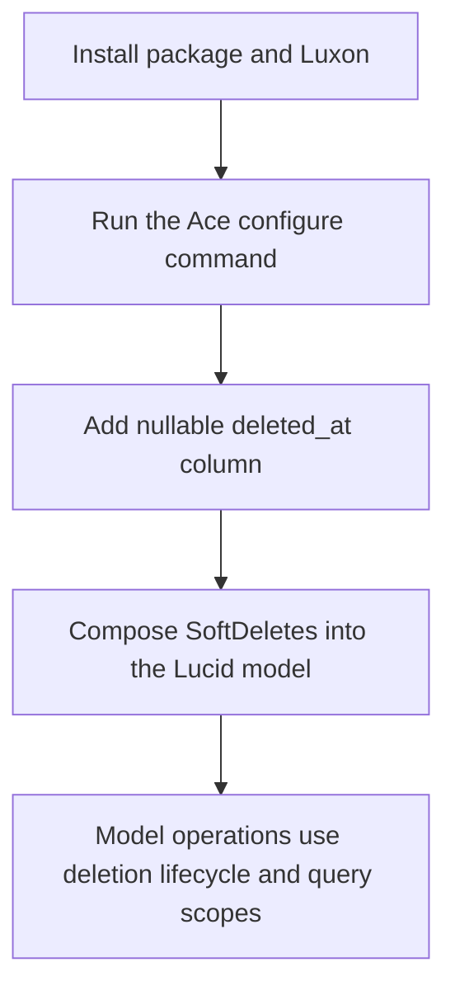
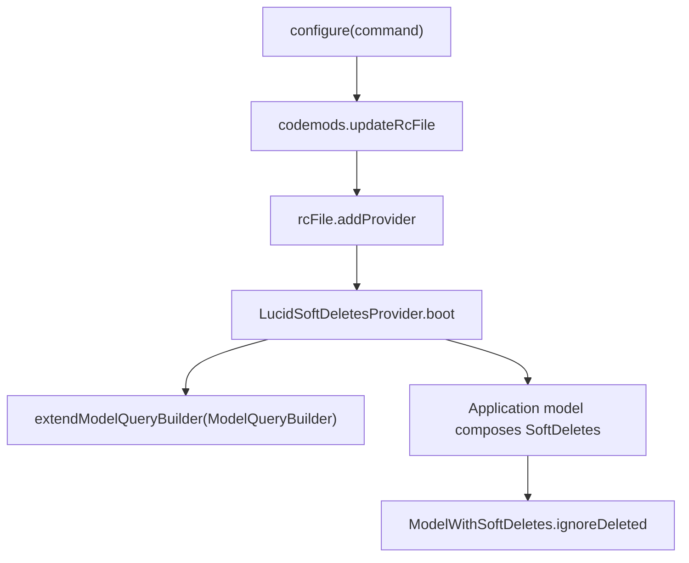

# US-DEV-01 — Configure the provider and model support

As an application developer, I want to register the package provider, add the nullable deletion timestamp to selected tables, and compose `SoftDeletes` into their models so that Lucid can persist deleted state and scope model reads.

**Status:** Operator; current package setup path.
**Access:** Application developer with permission to configure the app and database schema.
**Entry:** `node ace configure @kevinjohn/adonisjs-lucid-soft-delete`, then an application migration and model composition.
**Documentation:** [Getting started](../../docs/guide/getting-started.md).
**Source:** [Configure hook](../../configure.ts), [provider](../../providers/lucid_soft_delete_provider.ts), [model mixin](../../src/mixin.ts).
**Coverage:** [Configure tests](../../tests/configure.spec.ts), [provider tests](../../tests/provider.spec.ts).

## Acceptance criteria

- Ace configure adds the package provider to `adonisrc.ts`; the provider's `boot()` imports Lucid's `ModelQueryBuilder` and calls `extendModelQueryBuilder`.
- A soft-deletable table has a nullable timestamp column corresponding to the mixin's `deletedAt` column mapping.
- Composing `SoftDeletes` into the model installs Lucid fetch hooks and instance lifecycle methods for that model.
- This package does not create application routes, authentication, authorization, migrations, or a user interface.

## User flow

## Code flow

Scope: configure hook registers provider; provider boot extends Lucid builder; model mixin adds per-model fetch hooks.

**Code references:** [configure](../../configure.ts), [provider boot](../../providers/lucid_soft_delete_provider.ts), [builder extension](../../src/bindings/model_query_builder.ts), [mixin hooks](../../src/mixin.ts), [getting started](../../docs/guide/getting-started.md).
