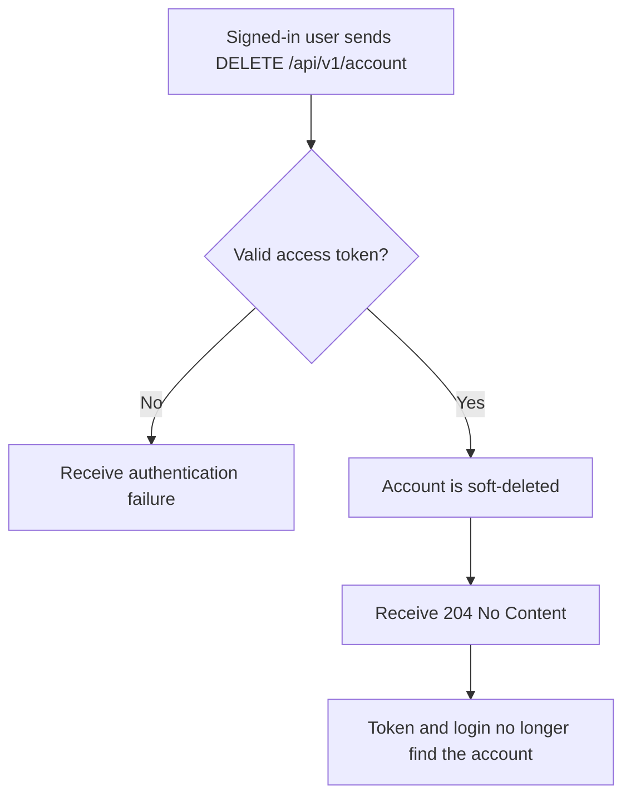
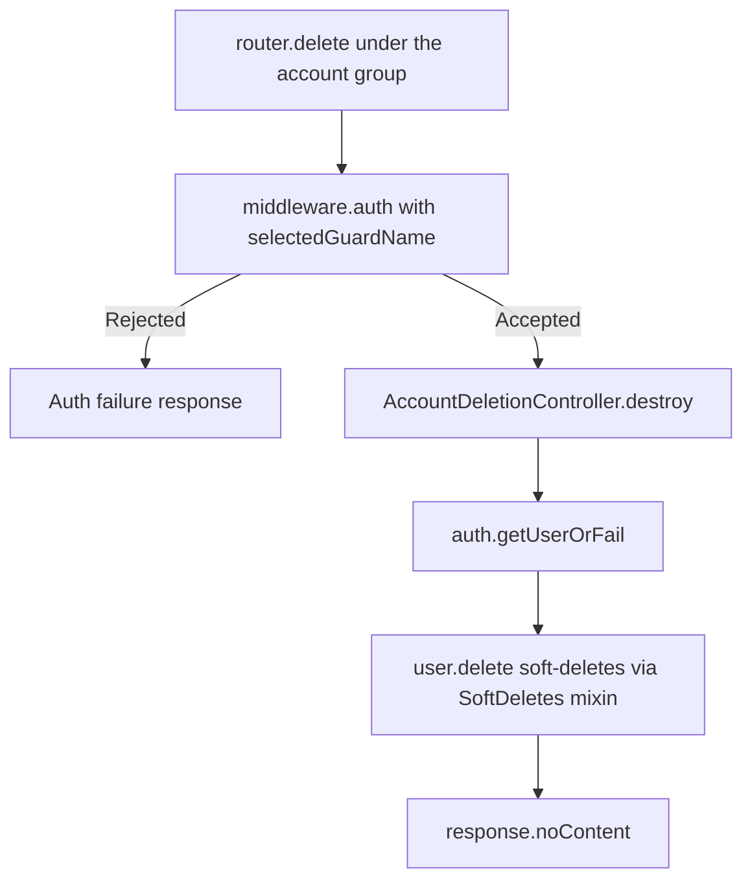

# US-DEMO-01 — Delete your own account through the API starter

As a signed-in user of the API starter app, I want to delete my account so that it stops authenticating while an administrator can still restore it.

**Status:** Demo; source-reviewed in the [v0.13.0 API app](https://github.com/Kevinjohn/oss-adonisjs-starter-examples/tree/v0.13.0/apps/api); the local native-auth contract fixture is retained but was not run for this documentation change.
**Access:** Authenticated API account (`middleware.auth({ guards: [selectedGuardName()] })`); the account deleted is always the caller's own. The local native-auth fixture covers bearer-token refusal while deleted and reuse after restoration.
**Entry:** `DELETE /api/v1/account`.
**Documentation:** [Instance lifecycle methods](../../docs/reference/README.md#instance-lifecycle-methods).
**Source:** [Routes](https://github.com/Kevinjohn/oss-adonisjs-starter-examples/blob/v0.13.0/apps/api/start/routes.ts) (lines 141-150), [AccountDeletionController](https://github.com/Kevinjohn/oss-adonisjs-starter-examples/blob/v0.13.0/apps/api/app/controllers/account_deletion_controller.ts) (lines 8-11).
**Coverage:** [Local API native-auth contract tests](../../examples/starter/api/tests/functional/soft_delete.spec.ts).

## Acceptance criteria

- The route sits in the `account` group behind `middleware.auth({ guards: [selectedGuardName()] })`; a request without valid credentials never reaches the controller.
- `destroy` loads the signed-in user with `auth.getUserOrFail()`, calls `user.delete()` and returns `204 No Content`; the request takes no input fields.
- The row stays with `deletedAt` set. Ordinary `User` queries no longer find it, so the same issued bearer token authenticates before deletion, is refused while deleted, and authenticates again after [US-DEMO-02](us-demo-02-api-admin-restore.md) restores the account. Password login is refused while deleted.
- A failed write propagates as an error response; the controller does not catch it.

## User flow

## Code flow

Scope: starter route through the package's instance `delete()`; token issuing and the selected auth guard are AdonisJS behavior. The bearer-token sequence below is covered by the local native-auth contract fixture.

**Code references:** [routes](https://github.com/Kevinjohn/oss-adonisjs-starter-examples/blob/v0.13.0/apps/api/start/routes.ts), [controller](https://github.com/Kevinjohn/oss-adonisjs-starter-examples/blob/v0.13.0/apps/api/app/controllers/account_deletion_controller.ts), [SoftDeletes mixin](../../src/mixin.ts), [local API native-auth contract tests](../../examples/starter/api/tests/functional/soft_delete.spec.ts).
