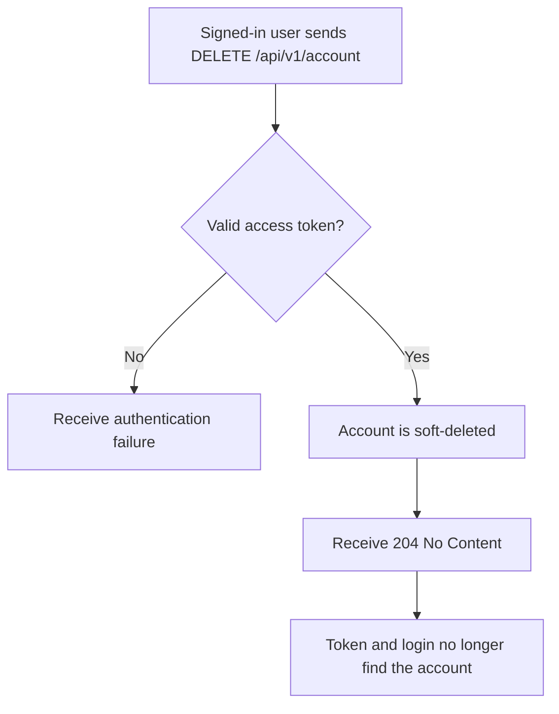
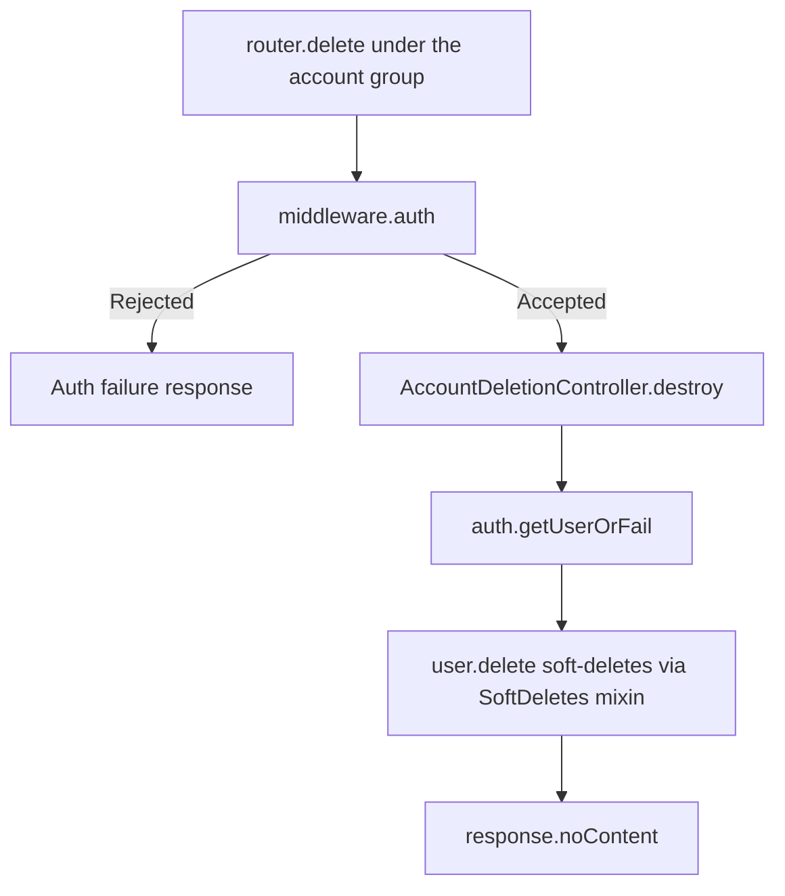

# US-DEMO-01 — Delete your own account through the API starter

As a signed-in user of the API starter app, I want to delete my account so that it stops authenticating while an administrator can still restore it.

**Status:** Demo; source-reviewed in the API starter example only, not runtime-tested here.
**Access:** Authenticated user (`middleware.auth()`); the account deleted is always the caller's own.
**Entry:** `DELETE /api/v1/account`.
**Documentation:** [Instance lifecycle methods](../../docs/reference/README.md#instance-lifecycle-methods).
**Source:** [Routes](../../examples/starter/api/start/routes.ts) (line 32), [AccountDeletionController](../../examples/starter/api/app/controllers/account_deletion_controller.ts) (lines 8-12).
**Coverage:** [API starter tests](../../examples/starter/api/tests/functional/soft_delete.spec.ts).

## Acceptance criteria

- The route sits in the `account` group behind `middleware.auth()`; a request without valid credentials never reaches the controller.
- `destroy` loads the signed-in user with `auth.getUserOrFail()`, calls `user.delete()` and returns `204 No Content`; the request takes no input fields.
- The row stays with `deletedAt` set. Ordinary `User` queries no longer find it, so its tokens stop authenticating and it cannot log in; [US-DEMO-02](us-demo-02-api-admin-restore.md) restores it.
- A failed write propagates as an error response; the controller does not catch it.

## User flow

## Code flow

Scope: starter route through the package's instance `delete()`; token issuing and the auth guard are AdonisJS behavior.

**Code references:** [routes](../../examples/starter/api/start/routes.ts), [controller](../../examples/starter/api/app/controllers/account_deletion_controller.ts), [SoftDeletes mixin](../../src/mixin.ts), [API starter tests](../../examples/starter/api/tests/functional/soft_delete.spec.ts).
