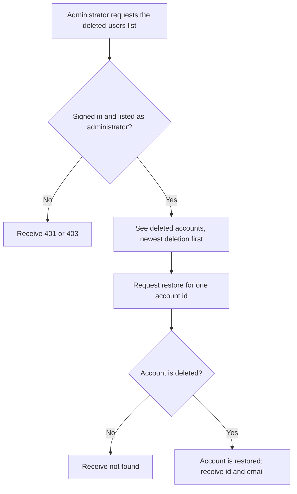
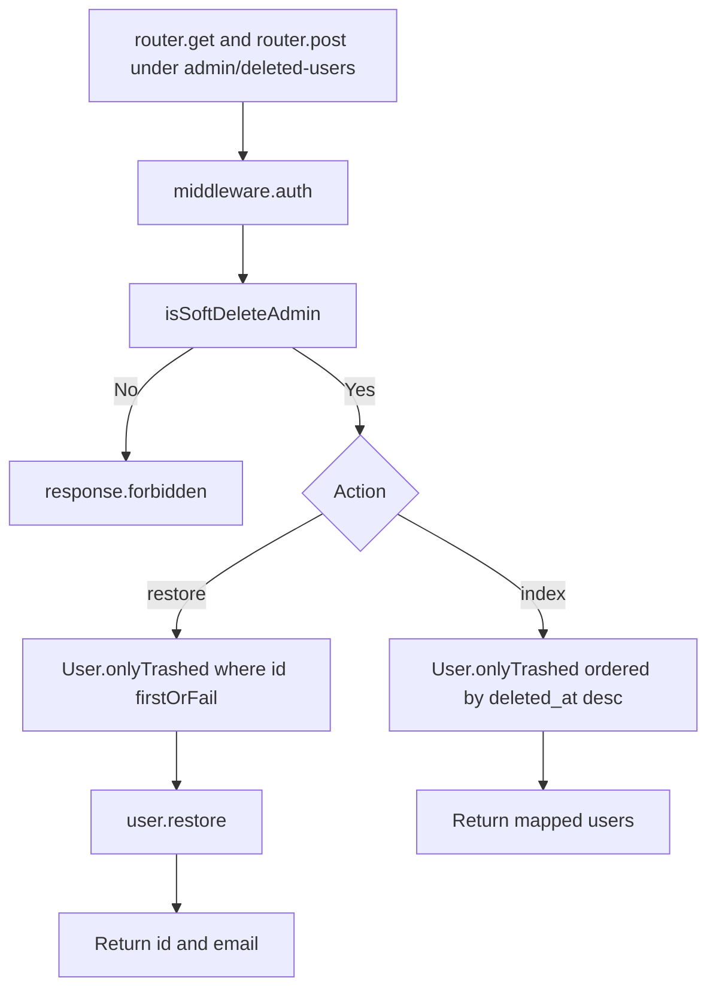

# US-DEMO-02 — List and restore deleted accounts through the API starter

As a soft-delete administrator of the API starter app, I want to list deleted accounts and restore one so that a user who deleted their account can be recovered.

**Status:** Demo; source-reviewed in the API starter example only, not runtime-tested here.
**Access:** Authenticated user whose email is listed in `SOFT_DELETE_ADMIN_EMAILS`, compared exactly and case-sensitively; others receive `403`.
**Entry:** `GET /api/v1/admin/deleted-users` and `POST /api/v1/admin/deleted-users/:id/restore`.
**Documentation:** [Read modes](../../docs/reference/README.md#read-modes), [Instance lifecycle methods](../../docs/reference/README.md#instance-lifecycle-methods).
**Source:** [Routes](../../examples/starter/api/start/routes.ts) (lines 40-41), [DeletedUsersController](../../examples/starter/api/app/controllers/deleted_users_controller.ts) (lines 11, 22), [admin check](../../examples/starter/api/app/services/soft_delete_admins.ts).
**Coverage:** [API starter tests](../../examples/starter/api/tests/functional/soft_delete.spec.ts).

## Acceptance criteria

- Both routes sit behind `middleware.auth()`; a non-administrator receives `403` with an `errors` message before any query runs.
- `index` returns `User.onlyTrashed()` ordered by `deleted_at` descending, each as `id`, `email` and ISO `deletedAt`.
- `restore` finds the user with `onlyTrashed().where('id', params.id).firstOrFail()` and calls `restore()`, returning `id` and `email`. An id that is missing or not trashed fails as not found.
- The administrator list comes from the environment, not the database; an address differing only in case is not an administrator.

## User flow

## Code flow

Scope: starter routes and controller through `onlyTrashed()` and `restore()`.

**Code references:** [routes](../../examples/starter/api/start/routes.ts), [controller](../../examples/starter/api/app/controllers/deleted_users_controller.ts), [admin check](../../examples/starter/api/app/services/soft_delete_admins.ts), [SoftDeletes mixin](../../src/mixin.ts), [API starter tests](../../examples/starter/api/tests/functional/soft_delete.spec.ts).
