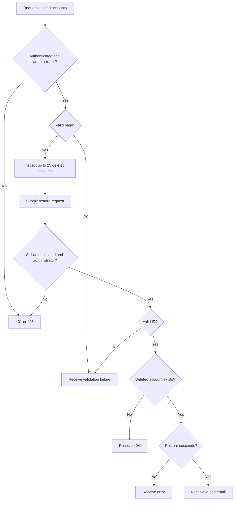
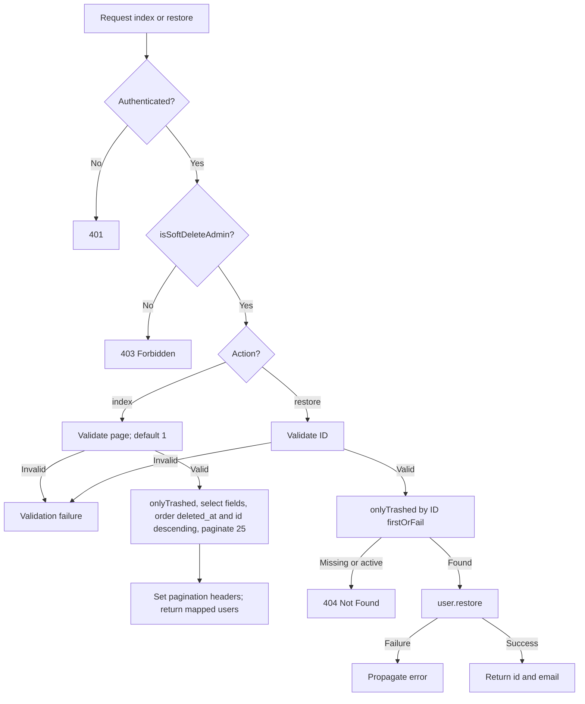

# US-DEMO-02 — List and restore deleted accounts through the API starter

As a soft-delete administrator of the API starter app, I want to list deleted accounts and restore one so that a user who deleted their account can be recovered.

**Status:** Demo; source-reviewed in the [embedded API starter](../../examples/starter/api); the local native-auth contract fixture is retained but was not run for this documentation change.
**Access:** Account authenticated through the default api token guard and enrolled by an operator after creation by setting `users.is_soft_delete_admin` to true. Public signup cannot set the flag. A signed-in non-administrator receives `403`; a guest receives `401` from the auth middleware.
**Entry:** `GET /api/v1/admin/deleted-users` and `POST /api/v1/admin/deleted-users/:id/restore`.
**Documentation:** [Read modes](../../docs/reference/README.md#read-modes), [Instance lifecycle methods](../../docs/reference/README.md#instance-lifecycle-methods).
**Source:** [Routes](../../examples/starter/api/start/routes.ts), [DeletedUsersController](../../examples/starter/api/app/controllers/deleted_users_controller.ts), [admin check](../../examples/starter/api/app/services/soft_delete_admins.ts), [admin flag migration](../../examples/starter/api/database/migrations/1768620766696_add_soft_delete_admin_to_users.ts).
**Coverage:** [Local API native-auth contract tests](../../examples/starter/api/tests/functional/soft_delete.spec.ts).

## Acceptance criteria

- Both routes sit behind `middleware.auth()`; a non-administrator receives `403` with an `errors` message before validation or the recycle-bin query runs.
- `index` returns `User.onlyTrashed()` ordered by `deleted_at` then `id`, both descending, each as `id`, `email` and ISO `deletedAt`.
- `restore` finds the user with `onlyTrashed().where('id', params.id).firstOrFail()` and calls `restore()`, returning `id` and `email`. A valid ID for an absent or active row fails with 404. Validation rejects zero, signs, leading zeros and unsafe integer IDs before lookup.
- Page defaults to 1 and must be a positive whole number at most 1,000,000. Each page holds up to 25 rows. A valid page beyond the result set is empty. The API includes `X-Total-Count`, `X-Current-Page` and `X-Last-Page` headers.
- The administrator grant comes from the account row, defaults to false for new signups, and can be revoked by clearing the flag.

## User flow

## Code flow

Scope: starter routes and controller through `onlyTrashed()` and `restore()`.

**Code references:** [routes](../../examples/starter/api/start/routes.ts), [controller](../../examples/starter/api/app/controllers/deleted_users_controller.ts), [admin check](../../examples/starter/api/app/services/soft_delete_admins.ts), [admin flag migration](../../examples/starter/api/database/migrations/1768620766696_add_soft_delete_admin_to_users.ts), [operator setup](../../examples/starter/api/README.md#install-and-run), [SoftDeletes mixin](../../src/mixin.ts), [local API native-auth contract tests](../../examples/starter/api/tests/functional/soft_delete.spec.ts).
