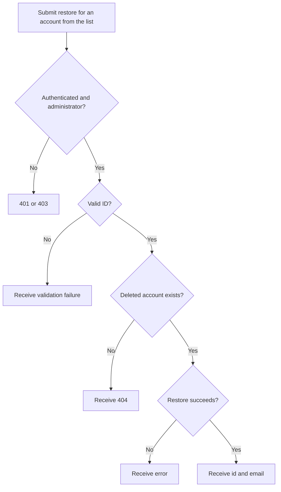
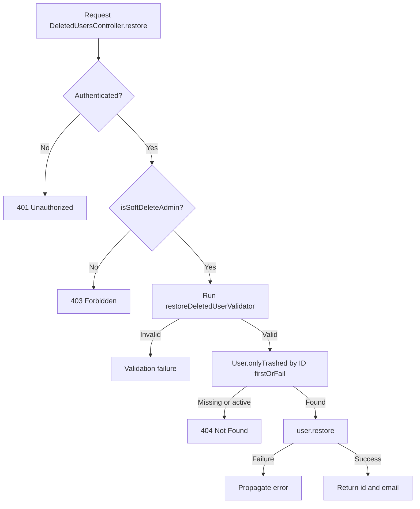

# US-DEMO-02 — Restore a deleted account in the api starter

As a soft-delete administrator of the api starter, I want to restore a deleted account so its member can sign in again.

**Status:** Demo, source-reviewed.
**Access:** Account authenticated through the default api token guard and enrolled by an operator after creation by setting `users.is_soft_delete_admin` to true. Public signup cannot set the flag. A signed-in non-administrator receives `403`; a guest receives `401` from the auth middleware.
**Entry:** Send `POST /api/v1/admin/deleted-users/:id/restore` with the account ID in the path. The request has no body fields.
**Documentation:** [Read modes](../../docs/reference/README.md#read-modes), [Instance lifecycle methods](../../docs/reference/README.md#instance-lifecycle-methods).
**Source:** [Routes](../../examples/starter/api/start/routes.ts), [DeletedUsersController](../../examples/starter/api/app/controllers/deleted_users_controller.ts), [admin check](../../examples/starter/api/app/services/soft_delete_admins.ts), [admin flag migration](../../examples/starter/api/database/migrations/1768620766696_add_soft_delete_admin_to_users.ts).
**Coverage:** [Local API native-auth contract tests](../../examples/starter/api/tests/functional/soft_delete.spec.ts).

## Acceptance criteria

- The restore route sits behind `middleware.auth()`; a non-administrator receives `403` with an `errors` message before validation or lookup.
- `restore` finds the user with `onlyTrashed().where('id', params.id).firstOrFail()` and calls `restore()`, returning `id` and `email`. A valid ID for an absent or active row fails with 404. Validation rejects zero, signs, leading zeros and IDs above 2,147,483,647 (the PostgreSQL `increments` range) before lookup.
- The administrator grant comes from the account row, defaults to false for new signups, and can be revoked by clearing the flag.

## User flow

## Code flow

**Code references:** [routes](../../examples/starter/api/start/routes.ts), [controller](../../examples/starter/api/app/controllers/deleted_users_controller.ts), [transformer](../../examples/starter/api/app/transformers/deleted_user_transformer.ts), [admin check](../../examples/starter/api/app/services/soft_delete_admins.ts), [admin flag migration](../../examples/starter/api/database/migrations/1768620766696_add_soft_delete_admin_to_users.ts), [operator setup](../../examples/starter/api/README.md#install-and-run), [withSoftDeletes mixin](../../src/mixin.ts), [local API native-auth contract tests](../../examples/starter/api/tests/functional/soft_delete.spec.ts), [validator](../../examples/starter/api/app/validators/deleted_user.ts).
