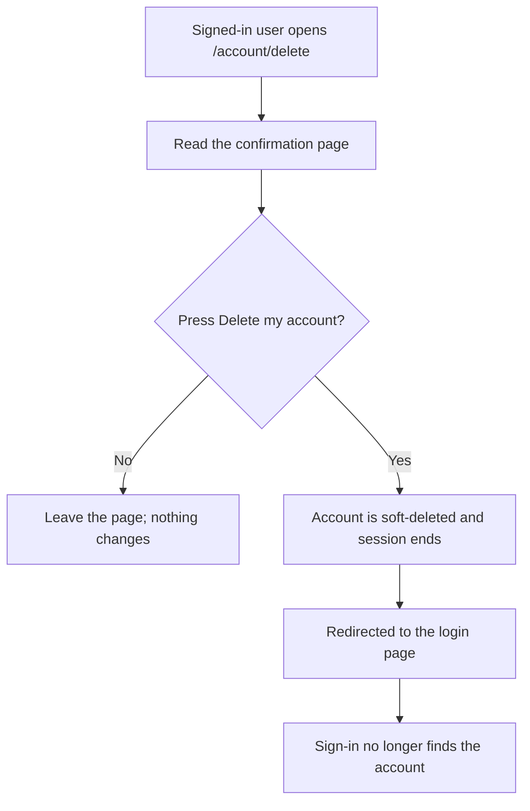
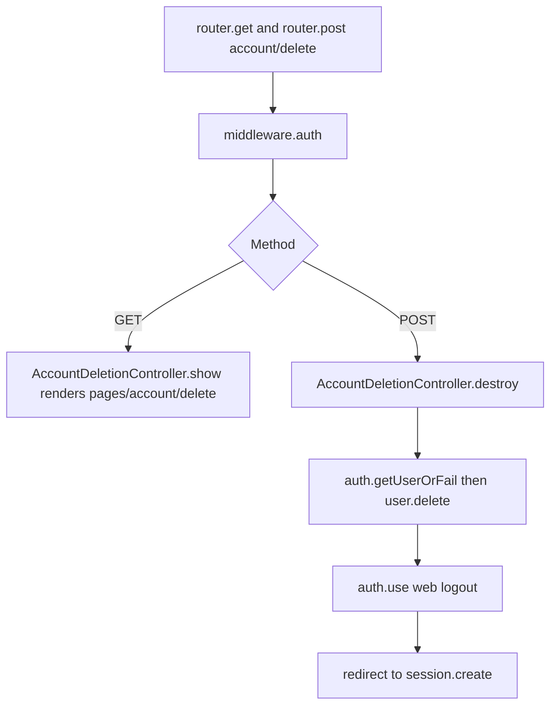

# US-DEMO-03 — Delete your own account through the hypermedia starter

As a signed-in user of the hypermedia starter app, I want to confirm and delete my account so that I am signed out and cannot sign in again unless an administrator restores it.

**Status:** Demo; source-reviewed in the hypermedia starter example only, not runtime-tested here.
**Access:** Authenticated user (`middleware.auth()`); the account deleted is always the caller's own.
**Entry:** `GET /account/delete` confirmation page, then its "Delete my account" button (`POST /account/delete`).
**Documentation:** [Instance lifecycle methods](../../docs/reference/README.md#instance-lifecycle-methods).
**Source:** [Routes](../../examples/starter/hypermedia/start/routes.ts) (lines 35-38), [AccountDeletionController](../../examples/starter/hypermedia/app/controllers/account_deletion_controller.ts) (lines 5, 13), [confirmation view](../../examples/starter/hypermedia/resources/views/pages/account/delete.edge).
**Coverage:** [Hypermedia starter functional tests](../../examples/starter/hypermedia/tests/functional/soft_delete.spec.ts).

## Acceptance criteria

- The page has one control, the "Delete my account" submit button, and no input fields. It warns that the account is hidden at once, the user is signed out and an administrator can restore it.
- `destroy` calls `user.delete()`, logs out the `web` guard and redirects to the `session.create` route.
- The row stays with `deletedAt` set; ordinary `User` queries no longer find it, so it cannot sign in. [US-DEMO-04](us-demo-04-hypermedia-admin-restore.md) restores it.
- A guest is redirected by `middleware.auth()` before either route runs. There is no separate cancel control other than leaving the page.

## User flow

## Code flow

Scope: starter routes and controller through the package's instance `delete()`; session and form handling are AdonisJS behavior.

**Code references:** [routes](../../examples/starter/hypermedia/start/routes.ts), [controller](../../examples/starter/hypermedia/app/controllers/account_deletion_controller.ts), [view](../../examples/starter/hypermedia/resources/views/pages/account/delete.edge), [SoftDeletes mixin](../../src/mixin.ts), [functional tests](../../examples/starter/hypermedia/tests/functional/soft_delete.spec.ts).
