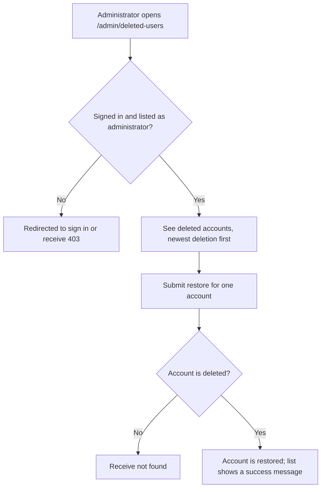
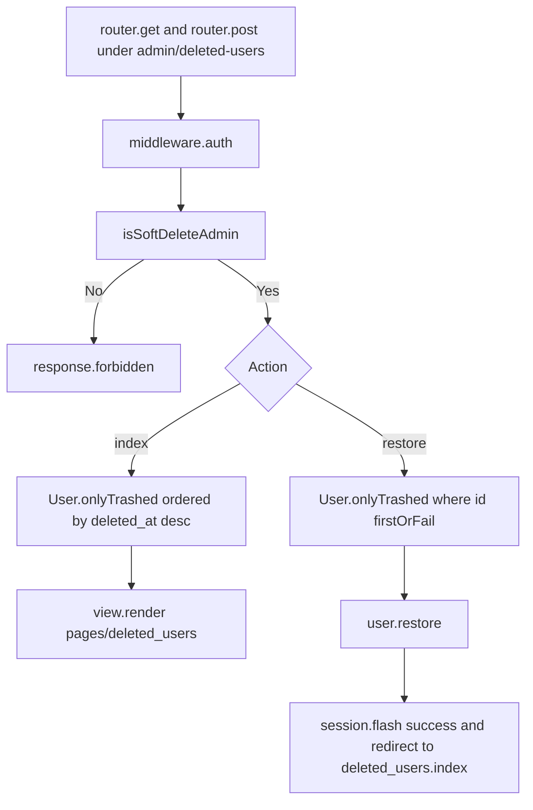

# US-DEMO-04 — List and restore deleted accounts in the hypermedia starter

As a soft-delete administrator of the hypermedia starter app, I want to see deleted accounts and restore one so that a user who deleted their account can sign in again.

**Status:** Demo; source-reviewed in the hypermedia starter example only, not runtime-tested here.
**Access:** Authenticated user whose email is listed in `SOFT_DELETE_ADMIN_EMAILS`, compared exactly and case-sensitively. A signed-in non-administrator receives `403`; a guest is redirected to `/login` by `middleware.auth()`.
**Entry:** `GET /admin/deleted-users` and `POST /admin/deleted-users/:id/restore`.
**Documentation:** [Read modes](../../docs/reference/README.md#read-modes), [Instance lifecycle methods](../../docs/reference/README.md#instance-lifecycle-methods).
**Source:** [Routes](../../examples/starter/hypermedia/start/routes.ts) (lines 39-42), [DeletedUsersController](../../examples/starter/hypermedia/app/controllers/deleted_users_controller.ts) (lines 9, 22), [admin check](../../examples/starter/hypermedia/app/services/soft_delete_admins.ts).
**Coverage:** [Functional tests](../../examples/starter/hypermedia/tests/functional/soft_delete.spec.ts), [browser tests](../../examples/starter/hypermedia/tests/browser/soft_delete.spec.ts).

## Acceptance criteria

- Both routes sit behind `middleware.auth()`; a non-administrator receives `403` before any query runs.
- `index` renders `pages/deleted_users` with `User.onlyTrashed()` ordered by `deleted_at` descending, each as `id`, `email` and an ISO-date `deletedAt`.
- `restore` finds the user with `onlyTrashed().where('id', params.id).firstOrFail()`, calls `restore()`, flashes "`<email>` is restored." and redirects to `deleted_users.index`. An id that is missing or not trashed fails as not found.
- The administrator list comes from the environment; an address differing only in case is not an administrator.

## User flow

## Code flow

Scope: starter routes and controller through `onlyTrashed()` and `restore()`; view markup is outside this flow.

**Code references:** [routes](../../examples/starter/hypermedia/start/routes.ts), [controller](../../examples/starter/hypermedia/app/controllers/deleted_users_controller.ts), [admin check](../../examples/starter/hypermedia/app/services/soft_delete_admins.ts), [SoftDeletes mixin](../../src/mixin.ts), [functional tests](../../examples/starter/hypermedia/tests/functional/soft_delete.spec.ts), [browser tests](../../examples/starter/hypermedia/tests/browser/soft_delete.spec.ts).
