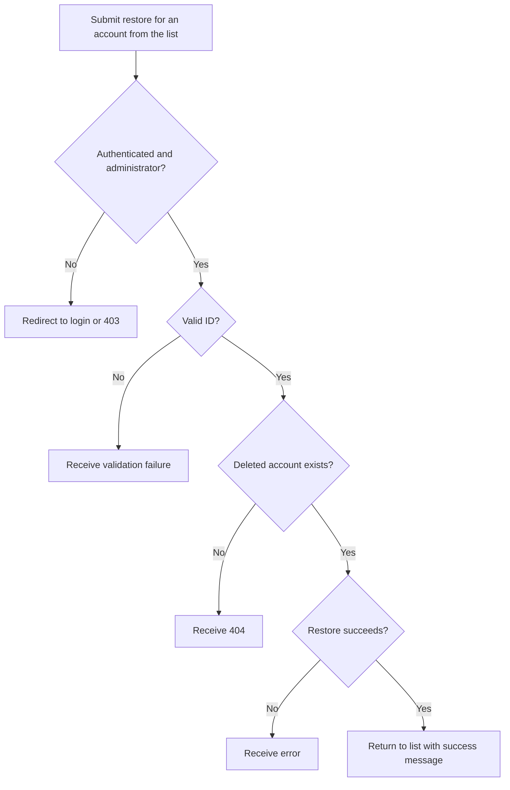
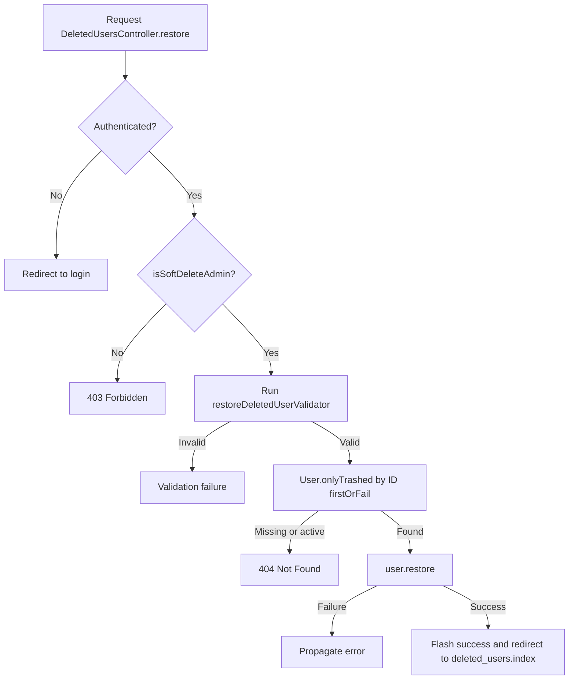

# US-DEMO-04 — Restore a deleted account in the hypermedia starter

As a soft-delete administrator of the hypermedia starter, I want to restore a deleted account so its member can sign in again.

**Status:** Demo, source-reviewed.
**Access:** Authenticated account that an operator enrolled after creation by setting `users.is_soft_delete_admin` to true. Public signup cannot set the flag. A signed-in non-administrator receives `403`; a guest is redirected to `/login` by `middleware.auth()`.
**Entry:** In the [Deleted accounts](us-demo-12-hypermedia-admin-list.md) list, use **Restore <email>** to submit `POST /admin/deleted-users/:id/restore`. The row provides the ID and the form has no user-entered fields.
**Documentation:** [Read modes](../../docs/reference/README.md#read-modes), [Instance lifecycle methods](../../docs/reference/README.md#instance-lifecycle-methods).
**Source:** [Routes](../../examples/starter/hypermedia/start/routes.ts), [DeletedUsersController](../../examples/starter/hypermedia/app/controllers/deleted_users_controller.ts), [admin check](../../examples/starter/hypermedia/app/services/soft_delete_admins.ts), [admin flag migration](../../examples/starter/hypermedia/database/migrations/1768620766696_add_soft_delete_admin_to_users.ts), [shared navigation](../../examples/starter/hypermedia/resources/views/components/layouts/app.edge), [navigation service](../../examples/starter/hypermedia/app/services/soft_delete_navigation.ts), [view helper](../../examples/starter/hypermedia/start/view.ts), [restore form](../../examples/starter/hypermedia/resources/views/pages/deleted_users.edge).
**Coverage:** [Local hypermedia native-auth contract tests](../../examples/starter/hypermedia/tests/functional/soft_delete.spec.ts), [local browser tests](../../examples/starter/hypermedia/tests/browser/soft_delete.spec.ts).

## Acceptance criteria

- The restore route requires `middleware.auth()` and checks the administrator grant before validation or lookup. A signed-in non-administrator receives `403`.
- `restore` finds the user with `onlyTrashed().where('id', params.id).firstOrFail()`, calls `restore()`, flashes "`<email>` is restored." and redirects to `deleted_users.index`. A valid ID for an absent or active row fails with 404. Validation rejects zero, signs, leading zeros and IDs above 2,147,483,647 (the PostgreSQL `increments` range) before lookup.
- The administrator grant comes from the account row, defaults to false for new signups, and can be revoked by clearing the flag.

## User flow

## Code flow

**Code references:** [routes](../../examples/starter/hypermedia/start/routes.ts), [controller](../../examples/starter/hypermedia/app/controllers/deleted_users_controller.ts), [admin check](../../examples/starter/hypermedia/app/services/soft_delete_admins.ts), [admin flag migration](../../examples/starter/hypermedia/database/migrations/1768620766696_add_soft_delete_admin_to_users.ts), [operator setup](../../examples/starter/hypermedia/README.md#install-and-run), [shared navigation](../../examples/starter/hypermedia/resources/views/components/layouts/app.edge), [navigation service](../../examples/starter/hypermedia/app/services/soft_delete_navigation.ts), [view helper](../../examples/starter/hypermedia/start/view.ts), [SoftDeletes mixin](../../src/mixin.ts), [local functional tests](../../examples/starter/hypermedia/tests/functional/soft_delete.spec.ts), [local browser tests](../../examples/starter/hypermedia/tests/browser/soft_delete.spec.ts)., [validator](../../examples/starter/hypermedia/app/validators/deleted_user.ts).
