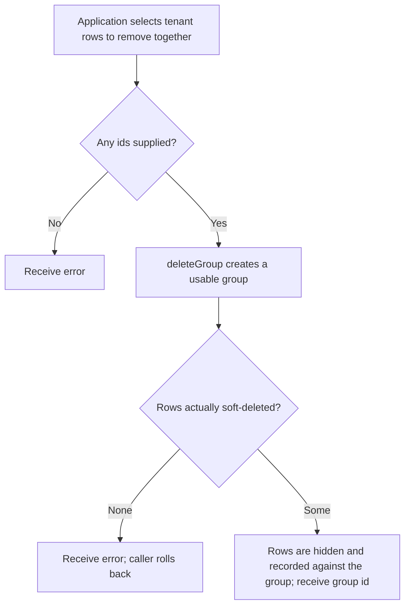
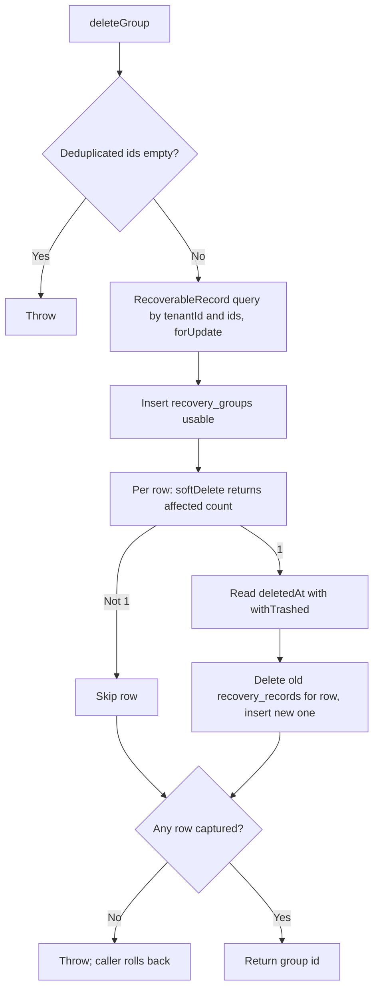

# US-DEMO-05 — Soft-delete rows as a recovery group in the example app

As application code in the example app, I want to soft-delete selected rows as one recovery group so that exactly the rows this call deleted can later be restored or purged together.

**Status:** Demo; source-reviewed in the example app service only, not runtime-tested here. The package does not ship group recovery; this is an application-owned recipe built on builder `softDelete()`.
**Access:** Application code holding a caller-owned transaction and a `tenantId` it has chosen and authorised; the service filters every query by that `tenantId`. Authorization and write serialisation are the caller's.
**Entry:** `deleteGroup(trx, { tenantId, ids, label })` in the example service.
**Documentation:** [Recipes](../../docs/recipes/index.md), [Builder lifecycle methods](../../docs/reference/README.md#builder-lifecycle-methods).
**Source:** [group_recovery.ts](../../examples/app/app/services/group_recovery.ts) (`deleteGroup` line 40).
**Coverage:** [Group recovery tests](../../examples/app/tests/group_recovery.spec.ts), [example tests](../../examples/app/tests/group_recovery_example.spec.ts).

## Acceptance criteria

- `deleteGroup` removes duplicate ids and rejects an empty id list before any write.
- It locks the tenant's active rows among the ids, creates a `usable` group, and calls `softDelete()` for each row. Only rows where `softDelete()` reports one update join the group, with their recorded `deletedAt`; any older association for that row is replaced.
- If no row was soft-deleted, it throws. It returns the new group id otherwise.
- It runs inside the caller's transaction and never rolls back itself; on a thrown error the caller must roll back to discard row and bookkeeping changes together.
- [US-DEMO-06](us-demo-06-restore-recovery-group.md) restores the group; [US-DEMO-07](us-demo-07-purge-recovery-group.md) invalidates and purges it.

## User flow

## Code flow

Scope: example service function through the builder `softDelete()` macro inside a caller transaction; transaction commit is caller-owned.

**Code references:** [group_recovery.ts](../../examples/app/app/services/group_recovery.ts), [recipes](../../docs/recipes/index.md), [builder macros](../../src/bindings/model_query_builder.ts), [group recovery tests](../../examples/app/tests/group_recovery.spec.ts).
