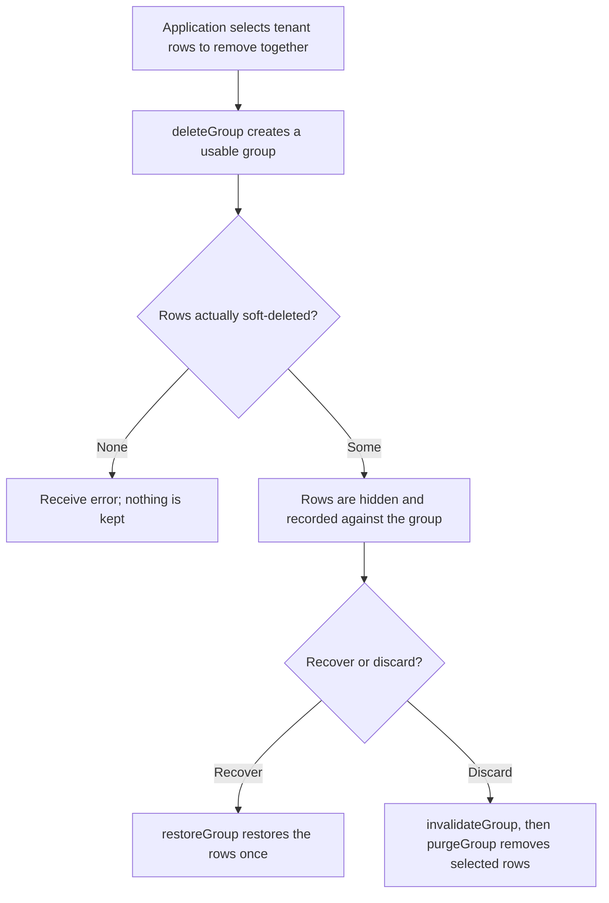
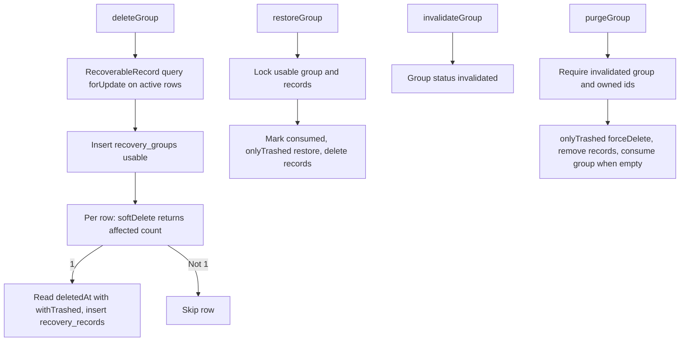

# US-DEMO-05 — Delete, restore and purge a recovery group in the example app

As application code in the example app, I want to soft-delete selected rows as one recovery group so that exactly those rows can be restored once, or permanently purged after the group is invalidated.

**Status:** Demo; source-reviewed in the example app service only, not runtime-tested here. The package does not ship group recovery; this is an application-owned recipe built on builder `softDelete()`, `restore()` and `forceDelete()`.
**Access:** Application code holding a caller-owned transaction; tenant scoping, authorization and write serialisation are the caller's.
**Entry:** `deleteGroup`, `invalidateGroup`, `restoreGroup` and `purgeGroup` in the example service.
**Documentation:** [Recipes](../../docs/recipes/index.md), [Builder lifecycle methods](../../docs/reference/README.md#builder-lifecycle-methods).
**Source:** [group_recovery.ts](../../examples/app/app/services/group_recovery.ts) (`deleteGroup` line 40, `restoreGroup` line 115, `purgeGroup` line 173).
**Coverage:** [Group recovery tests](../../examples/app/tests/group_recovery.spec.ts), [example tests](../../examples/app/tests/group_recovery_example.spec.ts).

## Acceptance criteria

- `deleteGroup(trx, { tenantId, ids, label })` rejects an empty id list, creates a `usable` group and, for each active tenant row, calls `softDelete()`. Only rows where it reports one update join the group; if none do, it throws.
- `restoreGroup` requires a `usable` group with current associations whose rows are all still trashed, marks the group `consumed`, then restores the rows with `onlyTrashed().restore()` and deletes the associations. A group restores once.
- `invalidateGroup` marks a `usable` group `invalidated` and keeps its associations.
- `purgeGroup` requires an `invalidated` group, at least one id, and that every selected row is currently associated with the group and trashed for the tenant; it then runs `onlyTrashed().forceDelete()`, removes those associations and marks the group `consumed` once none remain. A mismatch throws before any deletion.
- Every operation runs inside the caller's transaction, so a thrown error rolls back row and bookkeeping changes together.

## User flow

## Code flow

Scope: example service functions through builder lifecycle macros inside a caller transaction; transaction commit is caller-owned.

**Code references:** [group_recovery.ts](../../examples/app/app/services/group_recovery.ts), [recipes](../../docs/recipes/index.md), [builder macros](../../src/bindings/model_query_builder.ts), [group recovery tests](../../examples/app/tests/group_recovery.spec.ts).
