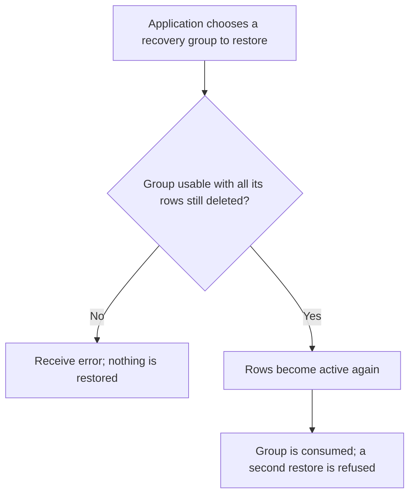
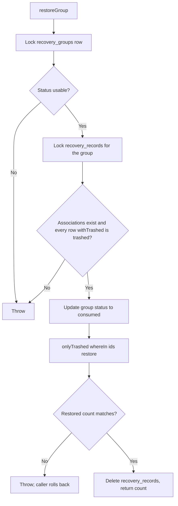

# US-DEMO-06 — Restore a recovery group in the example app

As application code in the example app, I want to restore a recovery group once so that exactly the rows it soft-deleted become active again with their original ids.

**Status:** Demo; source-reviewed in the example app service only, not runtime-tested here. The package does not ship group recovery; this is an application-owned recipe built on builder `onlyTrashed().restore()`.
**Access:** Application code holding a caller-owned transaction and a `tenantId` it has chosen and authorised; the service filters every query by that `tenantId`. Authorization and write serialisation are the caller's.
**Entry:** `restoreGroup(trx, { tenantId, groupId })` in the example service.
**Documentation:** [Recipes](../../docs/recipes/index.md), [Builder lifecycle methods](../../docs/reference/README.md#builder-lifecycle-methods).
**Source:** [group_recovery.ts](../../examples/app/app/services/group_recovery.ts) (`restoreGroup` line 115).
**Coverage:** [Group recovery tests](../../examples/app/tests/group_recovery.spec.ts), [example tests](../../examples/app/tests/group_recovery_example.spec.ts).

## Acceptance criteria

- `restoreGroup` requires a `usable` group for the tenant; a missing, `invalidated` or `consumed` group throws.
- The group must have current row associations, and every associated row must exist for the tenant and still be trashed; otherwise it throws before any write.
- It marks the group `consumed`, restores the rows with `onlyTrashed().restore()`, throws if fewer rows were restored than expected, deletes the group's associations and returns the restored count. A group restores once.
- It runs inside the caller's transaction and never rolls back itself; on a thrown error the caller must roll back to discard row and bookkeeping changes together.

## User flow

## Code flow

Scope: example service function through the builder `restore()` macro inside a caller transaction; transaction commit is caller-owned.

**Code references:** [group_recovery.ts](../../examples/app/app/services/group_recovery.ts), [recipes](../../docs/recipes/index.md), [builder macros](../../src/bindings/model_query_builder.ts), [group recovery tests](../../examples/app/tests/group_recovery.spec.ts).
