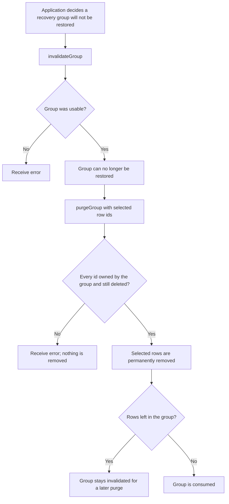
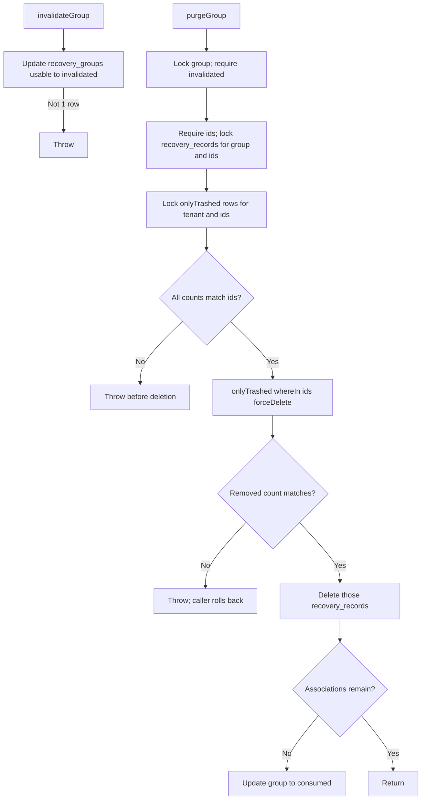

# US-DEMO-07 — Invalidate and purge a recovery group in the example app

As application code in the example app, I want to invalidate a recovery group and then permanently remove selected rows it still owns so that discarded rows are erased without touching rows a later group owns.

**Status:** Demo; source-reviewed in the example app service only, not runtime-tested here. The package does not ship group recovery; this is an application-owned recipe built on builder `onlyTrashed().forceDelete()`.
**Access:** Application code holding a caller-owned transaction and a `tenantId` it has chosen and authorised; the service filters every query by that `tenantId`. Authorization and write serialisation are the caller's.
**Entry:** `invalidateGroup(trx, { tenantId, groupId })`, then `purgeGroup(trx, { tenantId, groupId, ids })` in the example service. Invalidation disables restore and is the precondition for purge, so both share this story.
**Documentation:** [Recipes](../../docs/recipes/index.md), [Builder lifecycle methods](../../docs/reference/README.md#builder-lifecycle-methods).
**Source:** [group_recovery.ts](../../examples/app/app/services/group_recovery.ts) (`invalidateGroup` line 101, `purgeGroup` line 173).
**Coverage:** [Group recovery tests](../../examples/app/tests/group_recovery.spec.ts), [example tests](../../examples/app/tests/group_recovery_example.spec.ts).

## Acceptance criteria

- `invalidateGroup` changes a `usable` group to `invalidated` and keeps its associations; any other state throws.
- `purgeGroup` requires an `invalidated` group, at least one id, and that every selected id is currently associated with the group and trashed for the tenant. A mismatch throws before any deletion.
- It then runs `onlyTrashed().forceDelete()` on the selected ids, throws if fewer rows were removed than selected, deletes those associations and marks the group `consumed` once none remain. Unselected rows stay trashed and associated.
- Both functions run inside the caller's transaction and never roll back themselves; on a thrown error the caller must roll back to discard row and bookkeeping changes together.

## User flow

## Code flow

Scope: example service functions through the builder `forceDelete()` macro inside a caller transaction; transaction commit is caller-owned.

**Code references:** [group_recovery.ts](../../examples/app/app/services/group_recovery.ts), [recipes](../../docs/recipes/index.md), [builder macros](../../src/bindings/model_query_builder.ts), [group recovery tests](../../examples/app/tests/group_recovery.spec.ts).
