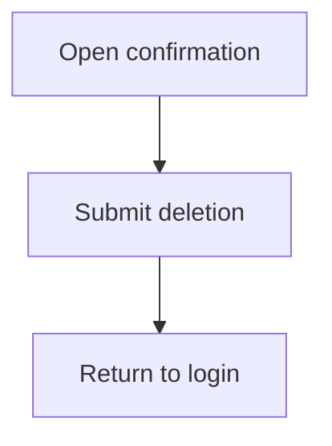
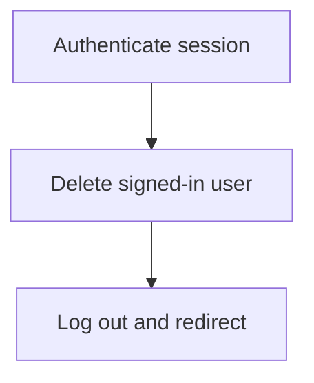

# US-DEMO-08 — Delete your own account in React and Vue

As a signed-in starter user, I want to confirm deletion so my account is hidden and my web session ends.

**Status:** Demo, source-reviewed.
**Access:** A signed-in starter user.
**Entry:** GET then POST /account/delete.
**Documentation:** [Package reference](../../docs/reference/README.md).
**Source:** [examples/starter/inertia_react/start/routes.ts](../../examples/starter/inertia_react/start/routes.ts), [examples/starter/inertia_react/app/controllers/account_deletion_controller.ts](../../examples/starter/inertia_react/app/controllers/account_deletion_controller.ts), [examples/starter/inertia_react/inertia/pages/account/delete.tsx](../../examples/starter/inertia_react/inertia/pages/account/delete.tsx), [examples/starter/inertia_vue/start/routes.ts](../../examples/starter/inertia_vue/start/routes.ts), [examples/starter/inertia_vue/app/controllers/account_deletion_controller.ts](../../examples/starter/inertia_vue/app/controllers/account_deletion_controller.ts), [examples/starter/inertia_vue/inertia/pages/account/delete.vue](../../examples/starter/inertia_vue/inertia/pages/account/delete.vue).
**Coverage:** [examples/starter/inertia_react/tests/functional/soft_delete.spec.ts](../../examples/starter/inertia_react/tests/functional/soft_delete.spec.ts), [examples/starter/inertia_vue/tests/functional/soft_delete.spec.ts](../../examples/starter/inertia_vue/tests/functional/soft_delete.spec.ts).

## Acceptance criteria

- GET renders the confirmation. Both routes require a signed-in session.
- POST deletes the authenticated user, logs out the web guard and redirects to login. The stored account remains recoverable.

## User flow

## Code flow

**Code references:** [examples/starter/inertia_react/start/routes.ts](../../examples/starter/inertia_react/start/routes.ts), [examples/starter/inertia_react/app/controllers/account_deletion_controller.ts](../../examples/starter/inertia_react/app/controllers/account_deletion_controller.ts), [examples/starter/inertia_react/inertia/pages/account/delete.tsx](../../examples/starter/inertia_react/inertia/pages/account/delete.tsx), [examples/starter/inertia_vue/start/routes.ts](../../examples/starter/inertia_vue/start/routes.ts), [examples/starter/inertia_vue/app/controllers/account_deletion_controller.ts](../../examples/starter/inertia_vue/app/controllers/account_deletion_controller.ts), [examples/starter/inertia_vue/inertia/pages/account/delete.vue](../../examples/starter/inertia_vue/inertia/pages/account/delete.vue).
