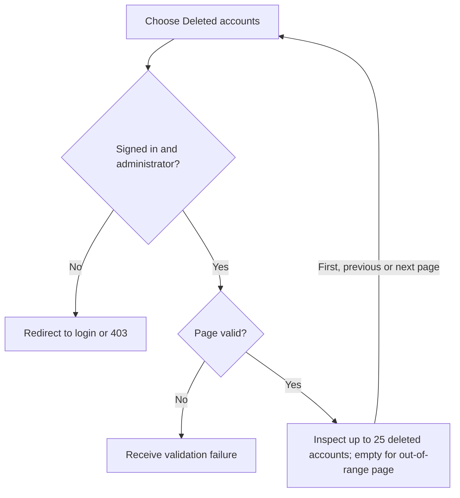
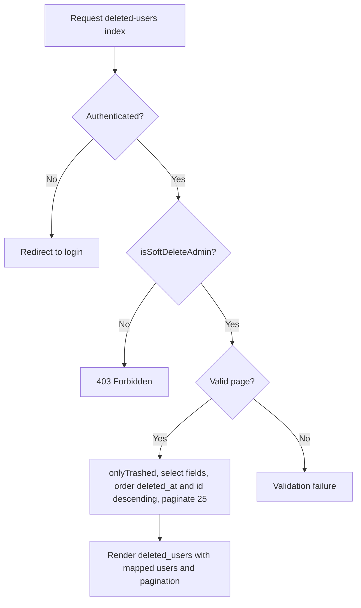

# US-DEMO-09 — Page through deleted accounts in React and Vue

As a soft-delete administrator, I want to page through deleted accounts so I can find an account to recover.

**Status:** Demo, source-reviewed.
**Access:** A signed-in account enrolled by an operator through `is_soft_delete_admin`; signup cannot grant this flag.
**Entry:** Follow **Deleted accounts** in the administrator navigation to `GET /admin/deleted-users`.
**Documentation:** [Package reference](../../docs/reference/README.md).
**Source:** [examples/starter/inertia_react/start/routes.ts](../../examples/starter/inertia_react/start/routes.ts), [examples/starter/inertia_react/app/controllers/deleted_users_controller.ts](../../examples/starter/inertia_react/app/controllers/deleted_users_controller.ts), [examples/starter/inertia_react/inertia/pages/deleted_users.tsx](../../examples/starter/inertia_react/inertia/pages/deleted_users.tsx), [examples/starter/inertia_react/app/validators/deleted_user.ts](../../examples/starter/inertia_react/app/validators/deleted_user.ts), [examples/starter/inertia_vue/start/routes.ts](../../examples/starter/inertia_vue/start/routes.ts), [examples/starter/inertia_vue/app/controllers/deleted_users_controller.ts](../../examples/starter/inertia_vue/app/controllers/deleted_users_controller.ts), [examples/starter/inertia_vue/inertia/pages/deleted_users.vue](../../examples/starter/inertia_vue/inertia/pages/deleted_users.vue), [examples/starter/inertia_vue/app/validators/deleted_user.ts](../../examples/starter/inertia_vue/app/validators/deleted_user.ts).
**Coverage:** [examples/starter/inertia_react/tests/functional/soft_delete.spec.ts](../../examples/starter/inertia_react/tests/functional/soft_delete.spec.ts), [examples/starter/inertia_vue/tests/functional/soft_delete.spec.ts](../../examples/starter/inertia_vue/tests/functional/soft_delete.spec.ts).

## Acceptance criteria

- The administrator check precedes validation. A signed-in user without the grant receives 403 and guests encounter authentication middleware.
- Page defaults to 1 and must be a positive integer at most 1,000,000. Select only trashed rows, up to 25 per page, newest deleted_at then highest id first.
- The page receives id, email and ISO calendar date for each result plus currentPage and lastPage. A valid out-of-range page is empty. **First page** and **Previous page** appear after page 1; **Next page** appears before the last page. Empty pages say **No account is deleted.** on page 1 and **No deleted accounts on this page.** otherwise.

## User flow

## Code flow

**Code references:** [examples/starter/inertia_react/start/routes.ts](../../examples/starter/inertia_react/start/routes.ts), [examples/starter/inertia_react/app/controllers/deleted_users_controller.ts](../../examples/starter/inertia_react/app/controllers/deleted_users_controller.ts), [examples/starter/inertia_react/inertia/pages/deleted_users.tsx](../../examples/starter/inertia_react/inertia/pages/deleted_users.tsx), [examples/starter/inertia_react/app/validators/deleted_user.ts](../../examples/starter/inertia_react/app/validators/deleted_user.ts), [examples/starter/inertia_vue/start/routes.ts](../../examples/starter/inertia_vue/start/routes.ts), [examples/starter/inertia_vue/app/controllers/deleted_users_controller.ts](../../examples/starter/inertia_vue/app/controllers/deleted_users_controller.ts), [examples/starter/inertia_vue/inertia/pages/deleted_users.vue](../../examples/starter/inertia_vue/inertia/pages/deleted_users.vue), [examples/starter/inertia_vue/app/validators/deleted_user.ts](../../examples/starter/inertia_vue/app/validators/deleted_user.ts).
