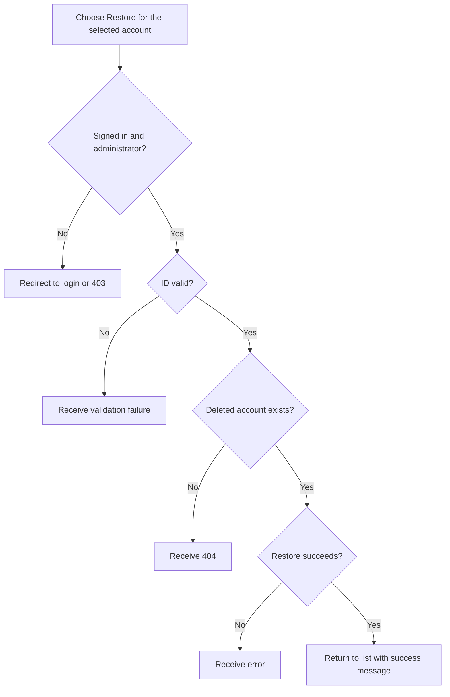
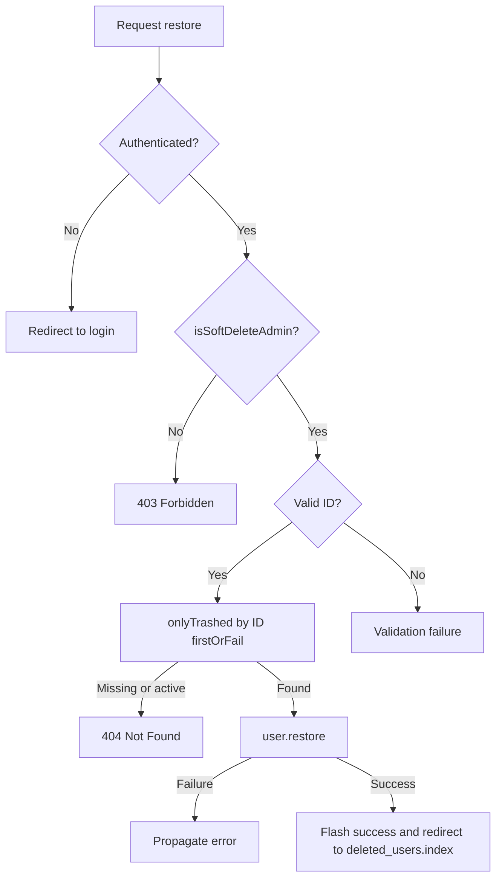

# US-DEMO-10 — Restore a deleted account in React and Vue

As a soft-delete administrator, I want to recover an account so its member can sign in again.

**Status:** Demo, source-reviewed.
**Access:** A signed-in account enrolled by an operator through `is_soft_delete_admin`; signup cannot grant this flag.
**Entry:** In the [Deleted accounts](us-demo-09-inertia-list.md) list, choose **Restore <email>** to post to `/admin/deleted-users/:id/restore`. The button uses the row ID, with no user-entered fields.
**Documentation:** [Package reference](../../docs/reference/README.md).
**Source:** [examples/starter/inertia_react/start/routes.ts](../../examples/starter/inertia_react/start/routes.ts), [examples/starter/inertia_react/app/controllers/deleted_users_controller.ts](../../examples/starter/inertia_react/app/controllers/deleted_users_controller.ts), [examples/starter/inertia_react/inertia/pages/deleted_users.tsx](../../examples/starter/inertia_react/inertia/pages/deleted_users.tsx), [examples/starter/inertia_react/app/validators/deleted_user.ts](../../examples/starter/inertia_react/app/validators/deleted_user.ts), [examples/starter/inertia_vue/start/routes.ts](../../examples/starter/inertia_vue/start/routes.ts), [examples/starter/inertia_vue/app/controllers/deleted_users_controller.ts](../../examples/starter/inertia_vue/app/controllers/deleted_users_controller.ts), [examples/starter/inertia_vue/inertia/pages/deleted_users.vue](../../examples/starter/inertia_vue/inertia/pages/deleted_users.vue), [examples/starter/inertia_vue/app/validators/deleted_user.ts](../../examples/starter/inertia_vue/app/validators/deleted_user.ts).
**Coverage:** [examples/starter/inertia_react/tests/functional/soft_delete.spec.ts](../../examples/starter/inertia_react/tests/functional/soft_delete.spec.ts), [examples/starter/inertia_vue/tests/functional/soft_delete.spec.ts](../../examples/starter/inertia_vue/tests/functional/soft_delete.spec.ts).

## Acceptance criteria

- Check the administrator flag before validating the identifier. Revoked administrators receive 403.
- The ID must be a positive decimal without leading zeros, at most 2,147,483,647 (the PostgreSQL `increments` range). An active or absent account fails lookup with 404; invalid input is rejected before lookup.
- Success clears deletedAt, flashes a message containing the email and redirects to the deleted-users index.

## User flow

## Code flow

**Code references:** [examples/starter/inertia_react/start/routes.ts](../../examples/starter/inertia_react/start/routes.ts), [examples/starter/inertia_react/app/controllers/deleted_users_controller.ts](../../examples/starter/inertia_react/app/controllers/deleted_users_controller.ts), [examples/starter/inertia_react/inertia/pages/deleted_users.tsx](../../examples/starter/inertia_react/inertia/pages/deleted_users.tsx), [examples/starter/inertia_react/app/validators/deleted_user.ts](../../examples/starter/inertia_react/app/validators/deleted_user.ts), [examples/starter/inertia_vue/start/routes.ts](../../examples/starter/inertia_vue/start/routes.ts), [examples/starter/inertia_vue/app/controllers/deleted_users_controller.ts](../../examples/starter/inertia_vue/app/controllers/deleted_users_controller.ts), [examples/starter/inertia_vue/inertia/pages/deleted_users.vue](../../examples/starter/inertia_vue/inertia/pages/deleted_users.vue), [examples/starter/inertia_vue/app/validators/deleted_user.ts](../../examples/starter/inertia_vue/app/validators/deleted_user.ts).
