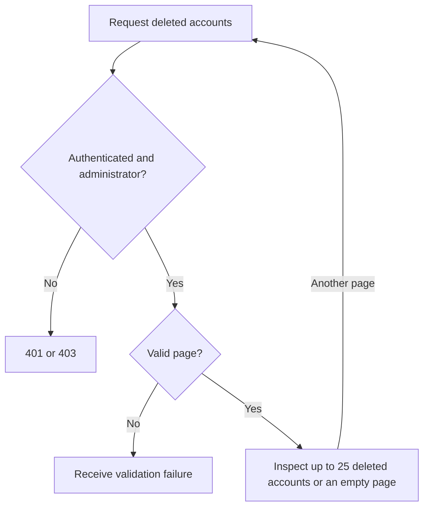
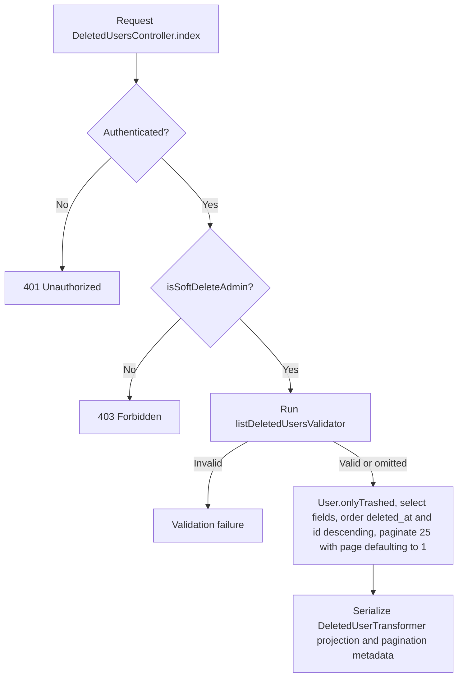

# US-DEMO-11 — List deleted accounts in the api starter

As a soft-delete administrator of the api starter, I want to page through deleted accounts so I can find an account to recover.

**Status:** Demo, source-reviewed.
**Access:** Account authenticated through the default api token guard and enrolled by an operator after creation by setting `users.is_soft_delete_admin` to true. Public signup cannot set the flag. A signed-in non-administrator receives `403`; a guest receives `401` from the auth middleware.
**Entry:** Send `GET /api/v1/admin/deleted-users` with an optional `page` query parameter.
**Documentation:** [Read modes](../../docs/reference/README.md#read-modes), [Instance lifecycle methods](../../docs/reference/README.md#instance-lifecycle-methods).
**Source:** [Routes](../../examples/starter/api/start/routes.ts), [DeletedUsersController](../../examples/starter/api/app/controllers/deleted_users_controller.ts), [admin check](../../examples/starter/api/app/services/soft_delete_admins.ts), [admin flag migration](../../examples/starter/api/database/migrations/1768620766696_add_soft_delete_admin_to_users.ts).
**Coverage:** [Local API native-auth contract tests](../../examples/starter/api/tests/functional/soft_delete.spec.ts).

## Acceptance criteria

- The list route sits behind `middleware.auth()`; a non-administrator receives `403` with an `errors` message before validation or the recycle-bin query runs.
- `index` returns `User.onlyTrashed()` ordered by `deleted_at` then `id`, both descending, each as `id`, `email` and ISO `deletedAt`, through `serialize(DeletedUserTransformer.paginate(...))`.
- Page defaults to 1 and must be a positive whole number at most 1,000,000. Each page holds up to 25 rows. A valid page beyond the result set has an empty `data` array. The response is `{ data, metadata }`, where `metadata` carries Lucid's pagination fields (`total`, `currentPage`, `lastPage` and the others); no pagination headers are set.
- Choose a deleted account from the result before [restoring it](us-demo-02-api-admin-restore.md).

## User flow

## Code flow

**Code references:** [routes](../../examples/starter/api/start/routes.ts), [controller](../../examples/starter/api/app/controllers/deleted_users_controller.ts), [transformer](../../examples/starter/api/app/transformers/deleted_user_transformer.ts), [admin check](../../examples/starter/api/app/services/soft_delete_admins.ts), [admin flag migration](../../examples/starter/api/database/migrations/1768620766696_add_soft_delete_admin_to_users.ts), [operator setup](../../examples/starter/api/README.md#install-and-run), [withSoftDeletes mixin](../../src/mixin.ts), [local API native-auth contract tests](../../examples/starter/api/tests/functional/soft_delete.spec.ts), [validator](../../examples/starter/api/app/validators/deleted_user.ts).
