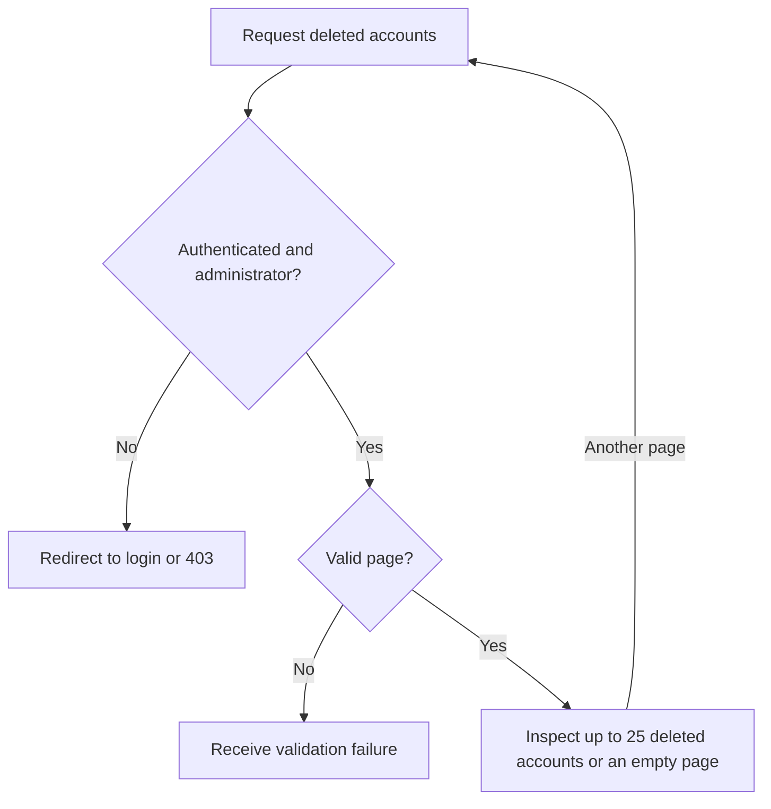
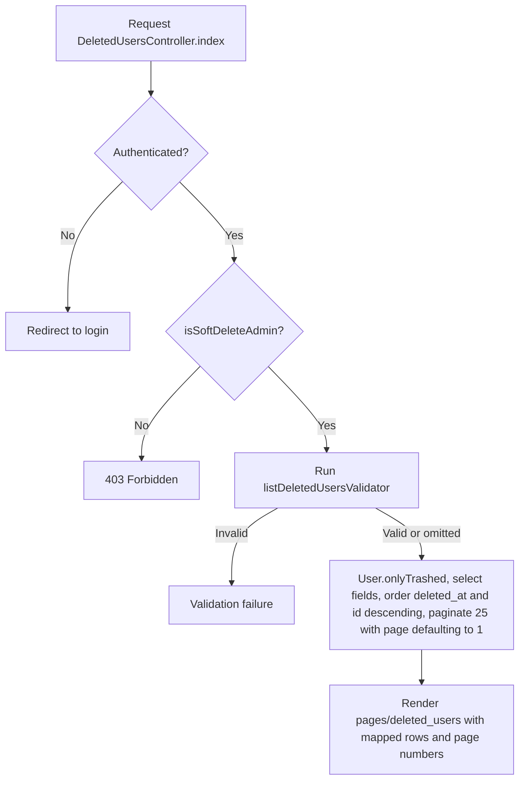

# US-DEMO-12 — List deleted accounts in the hypermedia starter

As a soft-delete administrator of the hypermedia starter, I want to page through deleted accounts so I can find an account to recover.

**Status:** Demo, source-reviewed.
**Access:** Authenticated account that an operator enrolled after creation by setting `users.is_soft_delete_admin` to true. Public signup cannot set the flag. A signed-in non-administrator receives `403`; a guest is redirected to `/login` by `middleware.auth()`.
**Entry:** Follow **Deleted accounts** in the signed-in administrator navigation to `GET /admin/deleted-users`.
**Documentation:** [Read modes](../../docs/reference/README.md#read-modes), [Instance lifecycle methods](../../docs/reference/README.md#instance-lifecycle-methods).
**Source:** [Routes](../../examples/starter/hypermedia/start/routes.ts), [DeletedUsersController](../../examples/starter/hypermedia/app/controllers/deleted_users_controller.ts), [admin check](../../examples/starter/hypermedia/app/services/soft_delete_admins.ts), [admin flag migration](../../examples/starter/hypermedia/database/migrations/1768620766696_add_soft_delete_admin_to_users.ts), [shared navigation](../../examples/starter/hypermedia/resources/views/components/layouts/app.edge), [navigation service](../../examples/starter/hypermedia/app/services/soft_delete_navigation.ts), [view helper](../../examples/starter/hypermedia/start/view.ts).
**Coverage:** [Local hypermedia native-auth contract tests](../../examples/starter/hypermedia/tests/functional/soft_delete.spec.ts), [local browser tests](../../examples/starter/hypermedia/tests/browser/soft_delete.spec.ts).

## Acceptance criteria

- The dashboard navigation shows **Deleted accounts** only when the server evaluates the signed-in account as an enrolled administrator. The list route sits behind `middleware.auth()`; a non-administrator receives `403` before validation or the recycle-bin query runs.
- `index` renders `pages/deleted_users` with `User.onlyTrashed()` ordered by `deleted_at` then `id`, both descending, each as `id`, `email` and an ISO-date `deletedAt`.
- Page defaults to 1 and must be a positive whole number at most 1,000,000. Each page holds up to 25 rows. A valid page beyond the result set is empty. The view receives current and last page numbers.
- **Previous page** appears after page 1 and **Next page** appears before the last page. Empty pages show **No account is deleted.** on the first page and **No deleted accounts on this page.** otherwise.
- Choose a deleted account from the result before [restoring it](us-demo-04-hypermedia-admin-restore.md).

## User flow

## Code flow

**Code references:** [routes](../../examples/starter/hypermedia/start/routes.ts), [controller](../../examples/starter/hypermedia/app/controllers/deleted_users_controller.ts), [admin check](../../examples/starter/hypermedia/app/services/soft_delete_admins.ts), [admin flag migration](../../examples/starter/hypermedia/database/migrations/1768620766696_add_soft_delete_admin_to_users.ts), [operator setup](../../examples/starter/hypermedia/README.md#install-and-run), [shared navigation](../../examples/starter/hypermedia/resources/views/components/layouts/app.edge), [navigation service](../../examples/starter/hypermedia/app/services/soft_delete_navigation.ts), [view helper](../../examples/starter/hypermedia/start/view.ts), [SoftDeletes mixin](../../src/mixin.ts), [local functional tests](../../examples/starter/hypermedia/tests/functional/soft_delete.spec.ts), [local browser tests](../../examples/starter/hypermedia/tests/browser/soft_delete.spec.ts)., [validator](../../examples/starter/hypermedia/app/validators/deleted_user.ts), [deleted accounts view](../../examples/starter/hypermedia/resources/views/pages/deleted_users.edge).
