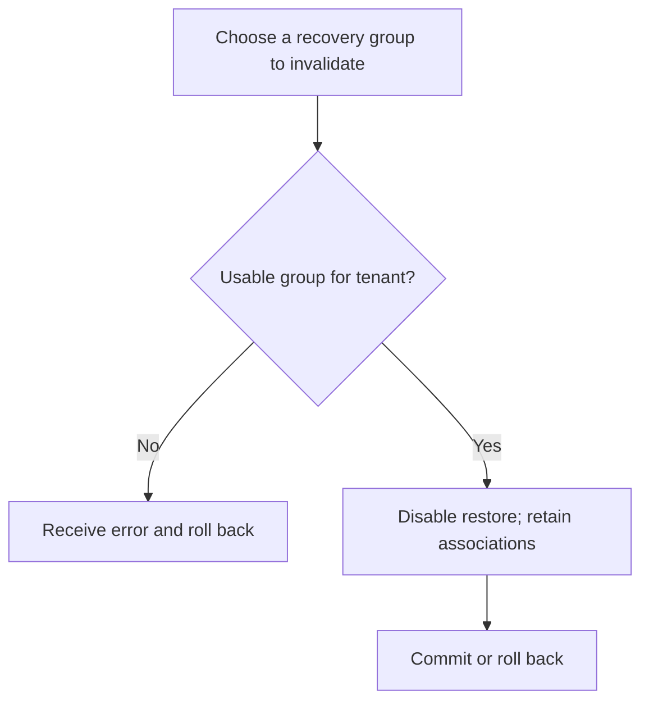
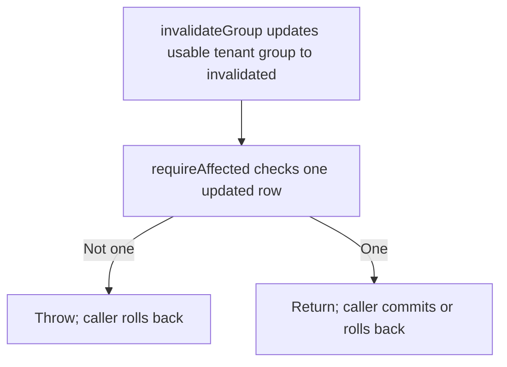

# US-DEMO-13 — Invalidate a recovery group

As application code in the example app, I want to invalidate a recovery group so it can no longer be restored while its ownership records remain available for cleanup.

**Status:** Demo; source-reviewed in the example service, not runtime-tested here.
**Access:** Application code with a caller-owned transaction and an authorised tenant; the host owns authorization and serialisation.
**Entry:** `invalidateGroup(trx, { tenantId, groupId })`.
**Documentation:** [Recipes](../../docs/recipes/index.md).
**Source:** [invalidateGroup](../../examples/app/app/services/group_recovery.ts#L101).
**Coverage:** [Group recovery tests](../../examples/app/tests/group_recovery.spec.ts).

## Acceptance criteria

- `trx` and `input` with numeric `tenantId` and string `groupId` are required; there are no defaults.
- The function changes one matching usable group to `invalidated`, leaving its associations intact. A missing or non-usable group throws. The caller must commit or roll back; the function does neither.
- [Purge selected rows](us-demo-07-purge-recovery-group.md) separately after invalidation. All writers must follow the documented per-tenant and ID serialisation protocol.

## User flow

## Code flow

Scope: example function within a caller-owned transaction.

**Code references:** [invalidateGroup and requireAffected](../../examples/app/app/services/group_recovery.ts#L101), [restoreGroup](../../examples/app/app/services/group_recovery.ts#L115), [purgeGroup](../../examples/app/app/services/group_recovery.ts#L173).
