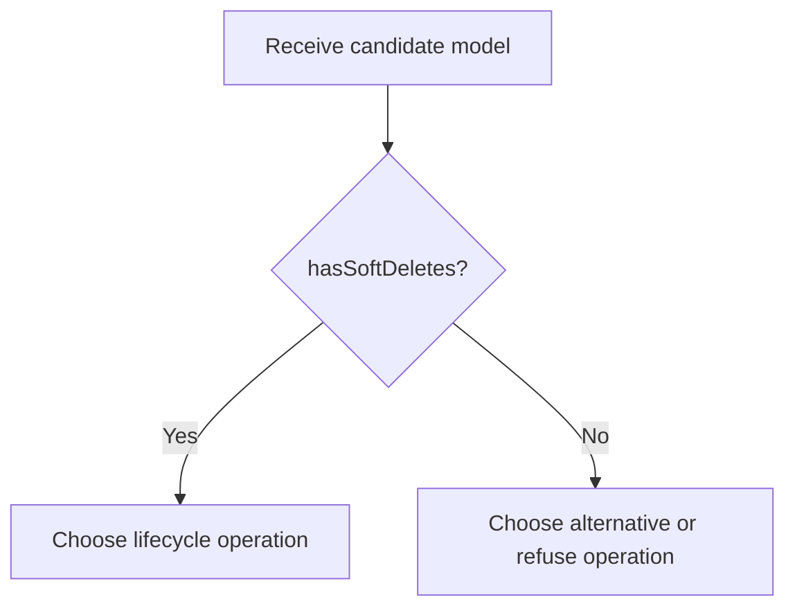
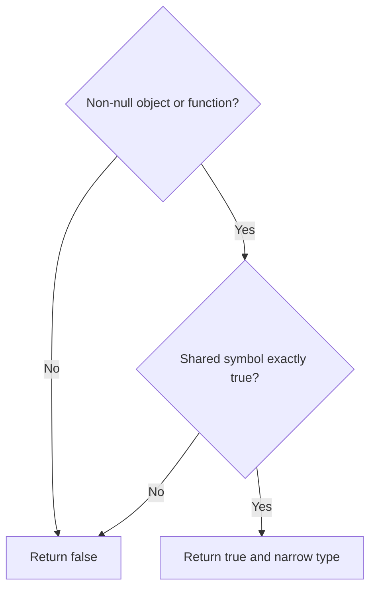

# US-APP-08 — Detect model support

As an application developer, I want to identify participating models so shared services can choose a supported operation.

**Status:** Current, source-reviewed.
**Access:** An application developer.
**Entry:** Call hasSoftDeletes on the constructor.
**Documentation:** [Package reference](../../docs/reference/README.md).
**Source:** [index.ts](../../index.ts), [src/guard.ts](../../src/guard.ts), [src/mixin.ts](../../src/mixin.ts).
**Coverage:** [tests/guard.spec.ts](../../tests/guard.spec.ts).

## Acceptance criteria

- The guard tests the SOFT_DELETES symbol for exactly true. A deletedAt column alone does not qualify.
- Null, primitives and unmarked models return false. A true result narrows the value to SoftDeletesModel.

## User flow

## Code flow

**Code references:** [index.ts](../../index.ts), [src/guard.ts](../../src/guard.ts), [src/mixin.ts](../../src/mixin.ts).
