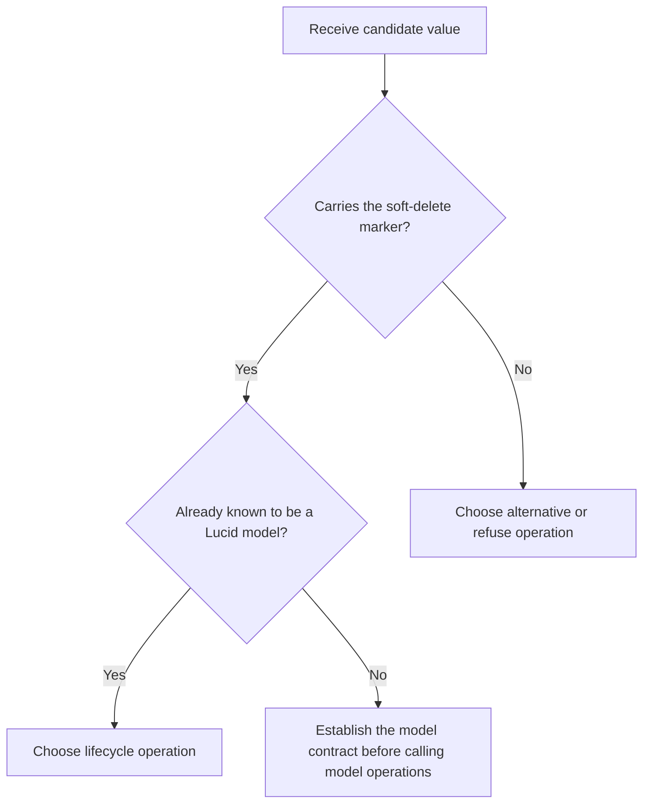
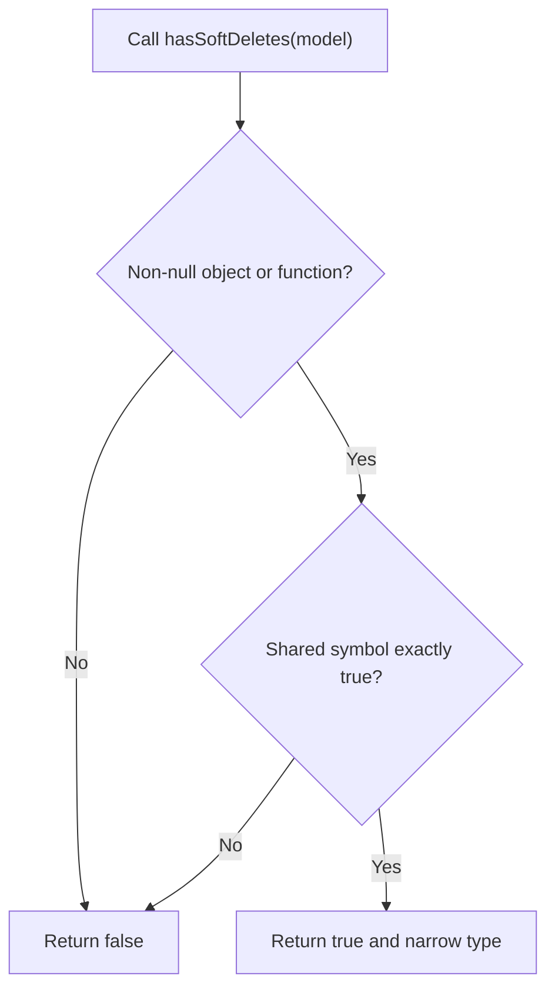

# US-APP-08 — Detect model support

As an application developer, I want to identify participating models so shared services can choose a supported operation.

**Status:** Current, source-reviewed.
**Access:** An application developer.
**Entry:** Call `hasSoftDeletes(model)` with a candidate value. A shared service that already has a Lucid constructor can use the result to select a soft-delete integration.
**Documentation:** [Package reference](../../docs/reference/README.md).
**Source:** [index.ts](../../index.ts), [src/guard.ts](../../src/guard.ts), [src/mixin.ts](../../src/mixin.ts).
**Coverage:** [tests/guard.spec.ts](../../tests/guard.spec.ts), [tests/types/model_check.spec.ts](../../tests/types/model_check.spec.ts) (type contract).

## Acceptance criteria

- The type guard tests the SOFT_DELETES symbol for exactly true. A deletedAt column alone does not qualify.
- Null, primitives and unmarked models return false. A true result adds the marker to the existing type. A known Lucid constructor narrows to `SoftDeletesModel`. An unknown value gains only the marker. An object carrying the marker also returns true, including an inherited marker. Establish the Lucid constructor contract separately before invoking model operations.

## User flow

## Code flow

**Code references:** [index.ts](../../index.ts), [src/guard.ts](../../src/guard.ts), [src/mixin.ts](../../src/mixin.ts).
