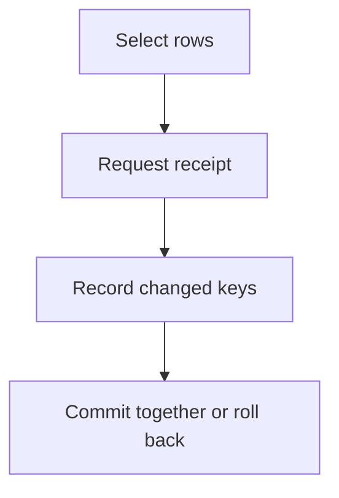
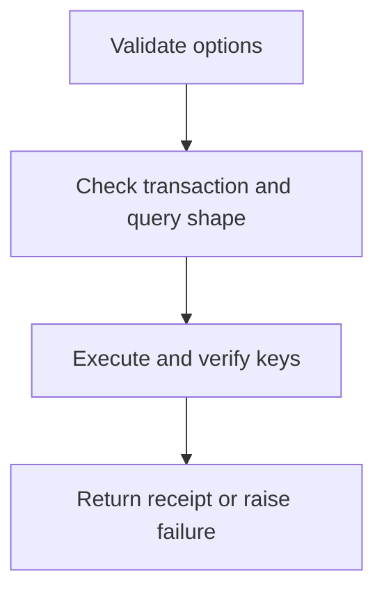

# US-APP-09 — Record the rows a bulk lifecycle write changed

As an application service, I want to collect changed primary keys so bookkeeping can commit with the mutation.

**Status:** Current, source-reviewed.
**Access:** An application service.
**Entry:** Pass `{ receipt: true }` to a bulk lifecycle method in a caller-owned transaction.
**Documentation:** [Package reference](../../docs/reference/README.md).
**Source:** [src/bindings/model_query_builder.ts](../../src/bindings/model_query_builder.ts), [src/receipts.ts](../../src/receipts.ts).
**Coverage:** [tests/builder_receipts.spec.ts](../../tests/builder_receipts.spec.ts), [tests/receipt_lock_wait.spec.ts](../../tests/receipt_lock_wait.spec.ts).

## Acceptance criteria

- Soft-delete, restore and force-delete receipts contain count and unordered distinct ids. Only soft-delete adds deletedAt, null for zero changes.
- Omitting receipt or using false returns the ordinary count. Receipt mode requires a transaction and a supported query shape, including eligible has-many builders. Unsupported shapes are refused before mutation.
- A divergence between selection and write raises an error. Database failures propagate. A receipt only describes a durable write after commit.

## User flow

## Code flow

**Code references:** [src/bindings/model_query_builder.ts](../../src/bindings/model_query_builder.ts), [src/receipts.ts](../../src/receipts.ts).
