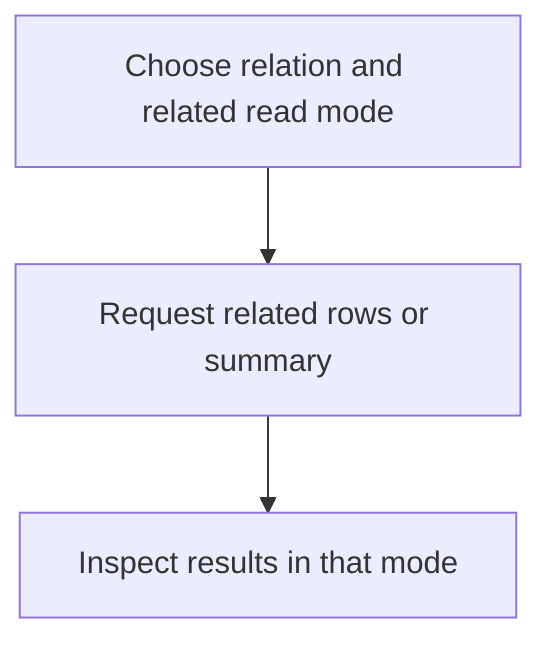
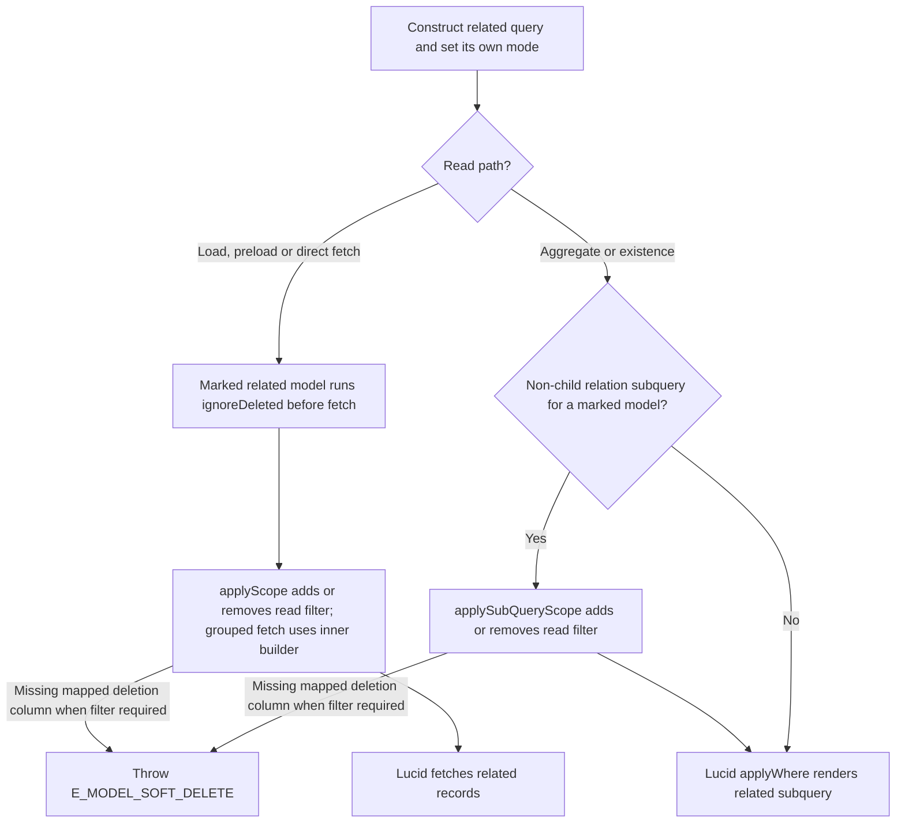

# US-APP-10 — Load related records in the intended read mode

As an application developer, I want to select the right related rows so details and summary counts agree.

**Status:** Current, source-reviewed.
**Access:** An application developer.
**Entry:** Use Lucid preload, load, related queries, aggregates or existence checks.
**Documentation:** [Package reference](../../docs/reference/README.md).
**Source:** [src/mixin.ts](../../src/mixin.ts), [src/sub_query_scope.ts](../../src/sub_query_scope.ts), [src/propagation.ts](../../src/propagation.ts), [src/scope.ts](../../src/scope.ts), [relation read contract](../../docs/reference/scope-contract.md#related-model-queries).
**Coverage:** [tests/scope_relations.spec.ts](../../tests/scope_relations.spec.ts), [tests/scope_bypass.spec.ts](../../tests/scope_bypass.spec.ts), [tests/group_limit.spec.ts](../../tests/group_limit.spec.ts).

## Acceptance criteria

- When the related model uses `withSoftDeletes`, has-one, has-many, belongs-to, many-to-many and nested or through reads default to active rows. A hidden has-one can yield no related record.
- An explicit mode on the related query can include or isolate trashed children. With the provider installed, counts, aggregates and existence checks apply the related model’s read filter. For a grouped relation fetch, the filter runs inside the grouped query before the window selects rows. Raw joins and arbitrary SQL subqueries need explicit predicates.

## User flow

## Code flow

**Code references:** [src/mixin.ts](../../src/mixin.ts), [src/sub_query_scope.ts](../../src/sub_query_scope.ts), [src/propagation.ts](../../src/propagation.ts), [src/scope.ts](../../src/scope.ts), [relation read contract](../../docs/reference/scope-contract.md#related-model-queries).
