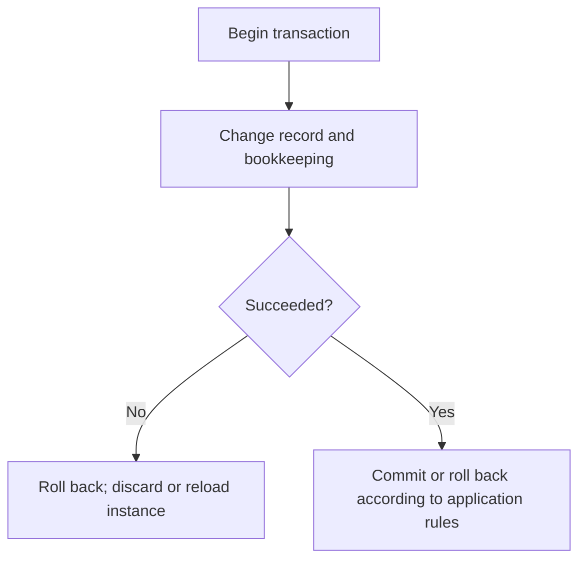
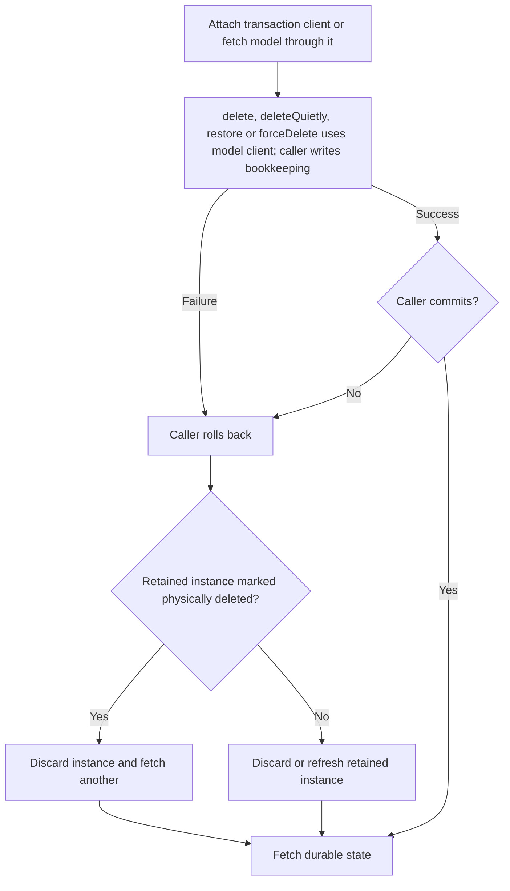

# US-APP-11 — Commit lifecycle changes with application bookkeeping

As an application service, I want to bind writes to one transaction so a failed request can roll back all changes.

**Status:** Current, source-reviewed.
**Access:** An application service.
**Entry:** Attach the transaction to the instance or fetch through its client.
**Documentation:** [Package reference](../../docs/reference/README.md).
**Source:** [src/mixin.ts](../../src/mixin.ts).
**Coverage:** [tests/transactions.spec.ts](../../tests/transactions.spec.ts), [tests/uniqueness.spec.ts](../../tests/uniqueness.spec.ts).

## Acceptance criteria

- Instance delete, quiet delete, restore and physical deletion honour the attached transaction. Include application bookkeeping on the same client.
- The caller decides when to commit. A post-write hook error can still leave changes pending in the transaction. Commit persists the database changes. Rollback undoes them but does not rewind a retained instance. For a soft delete or restore, discard or [refresh the retained instance](us-app-13-refresh-instance.md). After a force-delete rollback, fetch a new instance because Lucid still marks the retained one deleted.

## User flow

## Code flow

**Code references:** [src/mixin.ts](../../src/mixin.ts).
