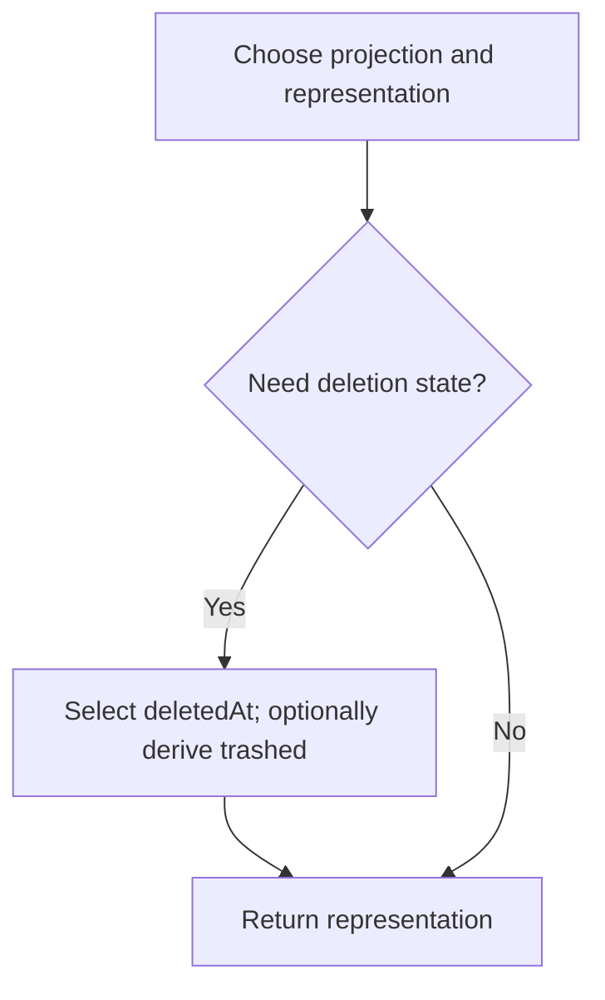
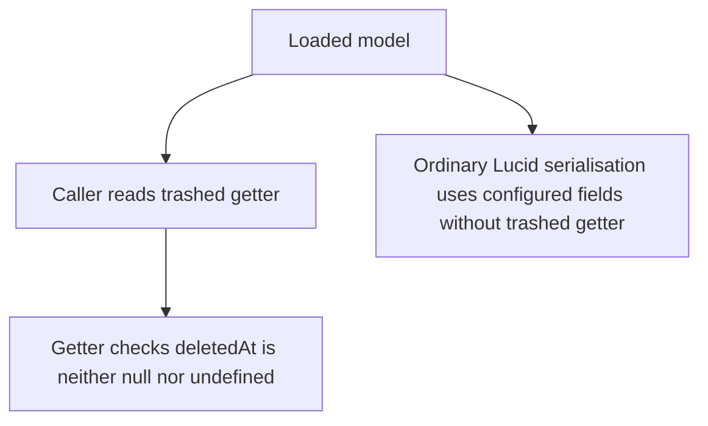

# US-APP-12 — Expose deletion state in a model response

As an application developer, I want to choose how to expose deletion state so clients receive the intended fields.

**Status:** Current, source-reviewed.
**Access:** An application developer.
**Entry:** Read the trashed getter or serialise the loaded model.
**Documentation:** [Package reference](../../docs/reference/README.md).
**Source:** [src/mixin.ts](../../src/mixin.ts).
**Coverage:** [tests/serialization.spec.ts](../../tests/serialization.spec.ts), [tests/model.spec.ts](../../tests/model.spec.ts).

## Acceptance criteria

- The mixin provides deletedAt and a derived trashed getter. Active records have a null timestamp. The getter evaluates false on projections that omit deletedAt, so select the attribute when deletion state matters.
- Ordinary serialisation includes the mapped date and omits the getter. A model can use a customised column mapping or serializeAs null to hide the timestamp.

## User flow

## Code flow

**Code references:** [src/mixin.ts](../../src/mixin.ts).
