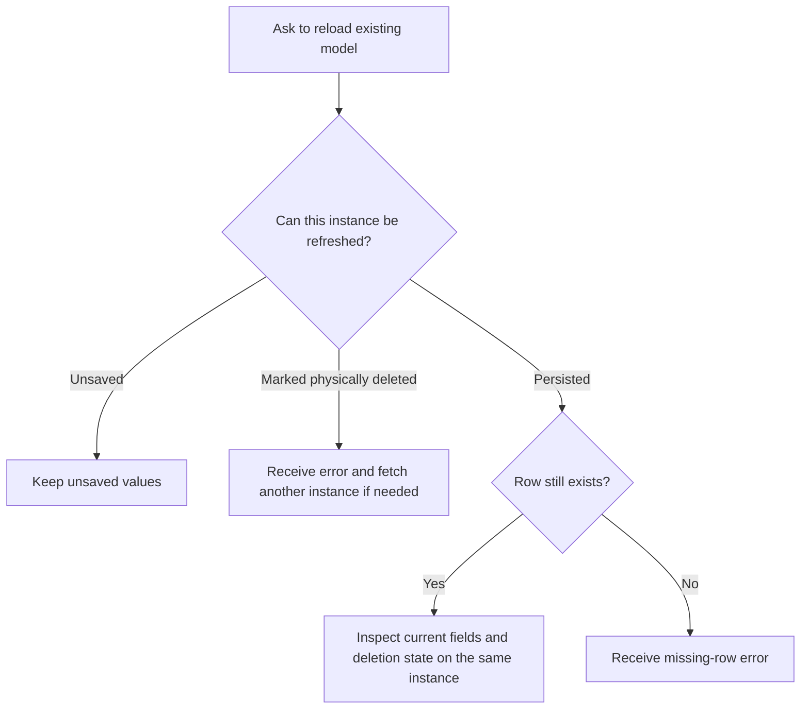
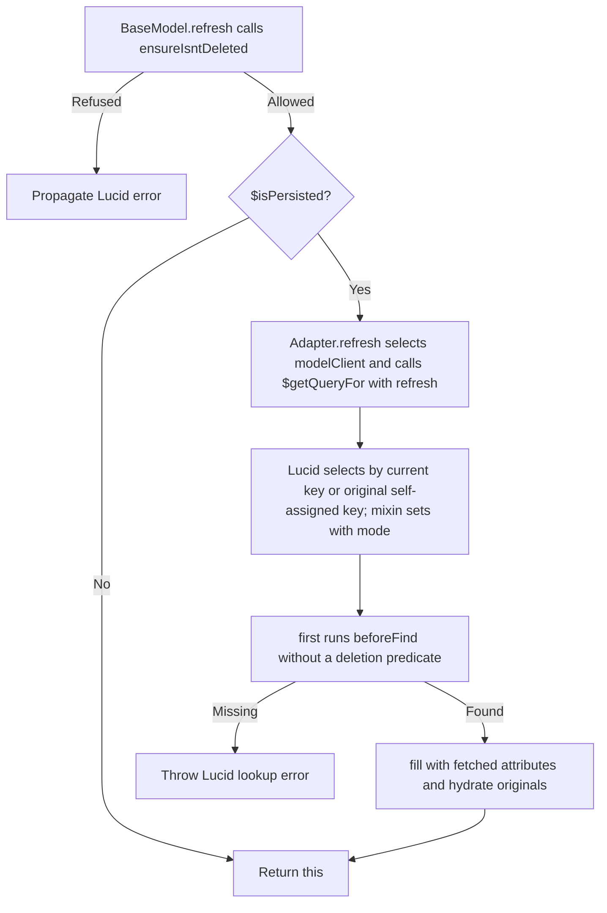

# US-APP-13 — Refresh an instance with its deletion state

As application code using a `withSoftDeletes` model, I want to reload an instance by its primary key so I can inspect its current deletion state even if an ordinary find would hide it.

**Status:** Current, source-reviewed.
**Access:** Application code holding a model instance. The host application owns access policy and any attached transaction.
**Entry:** Call the Lucid instance method `refresh()`.
**Documentation:** [Model fetches and builder lifecycle](../../docs/reference/scope-contract.md#model-fetches-and-builder-lifecycle).
**Source:** [withSoftDeletes query override](../../src/mixin.ts#L256).
**Coverage:** [Scope tests](../../tests/scope.spec.ts#L426), [custom deletion column and transaction](../../tests/lifecycle.spec.ts#L875), [rollback tests](../../tests/transactions.spec.ts#L73).

## Acceptance criteria

- A persisted instance can reload a row by its Lucid lookup key, including a trashed row. Lucid normally uses the instance's current primary key and uses the original key for self-assigned primary keys. The projection must retain the lookup key. A projection with that key that omitted `deletedAt` can be refreshed before [restoration](../restore-instance/us-app-03-restore-instance.md). The call fills the same instance with the fetched attributes, including the mapped `deletedAt` value, and resets its original attributes to the reloaded state.
- Lucid uses the attached transaction client if present. Refresh reads the row and changes only the retained instance in memory.
- Lucid returns an unsaved instance unchanged and rejects a retained instance it has marked physically deleted, even after an outer rollback restored the row. A separate persisted instance whose row is missing fails the lookup.

## User flow

## Code flow

**Code references:** [query override](../../src/mixin.ts#L256), [beforeFind](../../src/mixin.ts#L192), [applyScope](../../src/scope.ts#L76), [Lucid refresh contract](../../docs/reference/scope-contract.md#model-fetches-and-builder-lifecycle), [refresh tests](../../tests/scope.spec.ts#L426).
