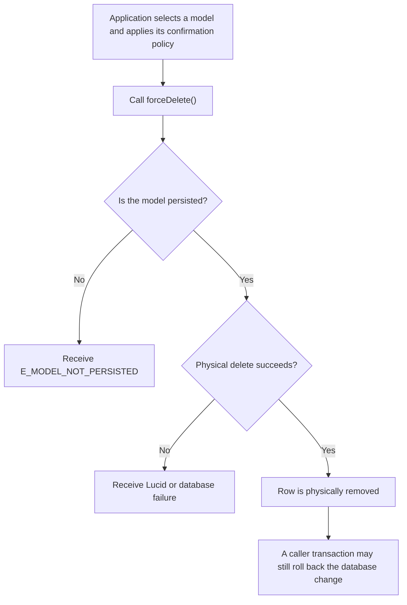
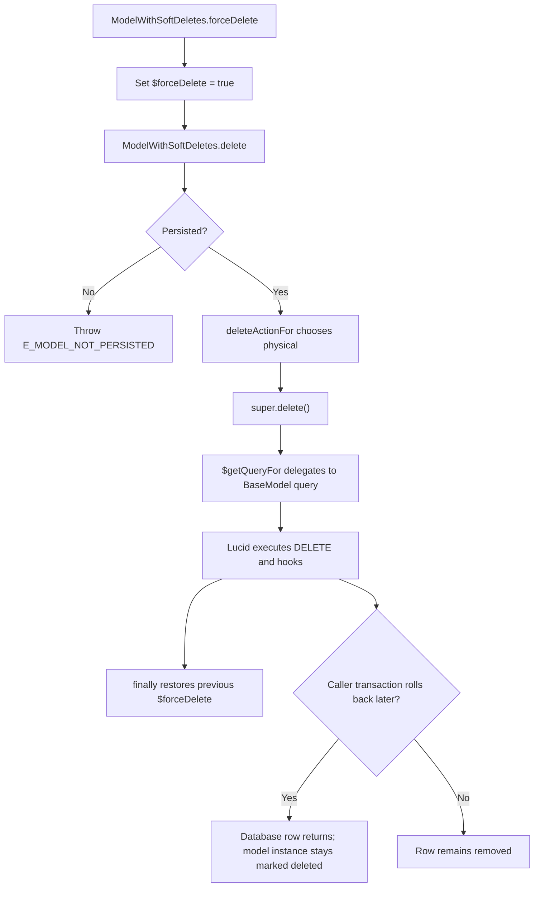

# US-APP-04 — Permanently remove an active or trashed model

As application code using a `SoftDeletes` model, I want to permanently delete one selected active or trashed model so that its row is physically removed when application policy requires it.

**Status:** Current; source-reviewed behavior, not runtime-tested here.
**Access:** Application code; application authorization, confirmation and retention policy are host-owned.
**Entry:** Call `forceDelete()` on a persisted active or trashed model instance.
**Documentation:** [Instance forceDelete contract](../../docs/reference/README.md#instance-forcedelete).
**Source:** [SoftDeletes.forceDelete and delete](../../src/mixin.ts).
**Coverage:** [Lifecycle tests](../../tests/lifecycle.spec.ts), [force-delete behavior](../../tests/model.spec.ts).

## Acceptance criteria

- `forceDelete()` stores the prior `$forceDelete` flag, sets it to `true`, calls `delete()`, then restores the prior flag in `finally` even when Lucid throws.
- The `deleteActionFor()` decision uses the force flag to choose Lucid's physical-delete path for persisted active or trashed instances; the operation is not limited to trashed records.
- An unsaved instance is refused with `E_MODEL_NOT_PERSISTED` before the force flag is read.
- The physical delete follows Lucid hooks and database constraints. The row is removed; related rows follow database rules, not automatic package cascades.
- A failed operation propagates. If an enclosing caller-owned transaction later rolls back, the database row returns but the retained model instance remains marked deleted; fetch a new instance.

## User flow

## Code flow

Scope: model method through Lucid physical delete and caller transaction boundary.

**Code references:** [forceDelete, deleteActionFor and $getQueryFor](../../src/mixin.ts), [instance API contract](../../docs/reference/README.md#instance-forcedelete), [lifecycle tests](../../tests/lifecycle.spec.ts).
