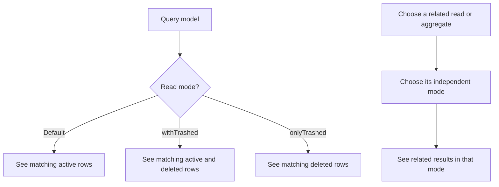
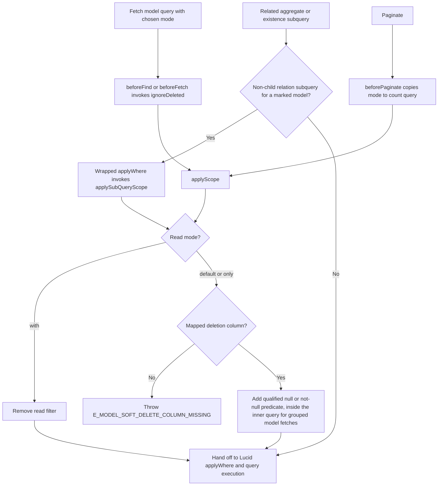

# US-APP-02 — Select active, all, or deleted models

As application code using a `SoftDeletes` model, I want to query active rows or explicitly include deleted rows so that ordinary reads stay clean while recovery workflows can inspect the recycle bin.

**Status:** Current; source-reviewed behavior, not runtime-tested here.
**Access:** Application code. The host application owns access policy. To reload an existing model by its primary key, see [refresh an instance](../integration/us-app-13-refresh-instance.md). Builder `withTrashed()`/`onlyTrashed()` and the read filter on relation subqueries require the booted provider, which calls `extendModelQueryBuilder`. Install it wherever the model is used: without it a cloned query loses its read mode and falls back to active rows, and predicates a later fetch hook adds are not regrouped with the read filter.
**Entry:** Model queries, `withTrashed()`, or `onlyTrashed()`.
**Documentation:** [Read modes](../../docs/reference/README.md#read-modes), [scope-contract.md](../../docs/reference/scope-contract.md).
**Source:** [SoftDeletes hooks and read modes](../../src/mixin.ts), [src/scope.ts](../../src/scope.ts).
**Coverage:** [read filter tests](../../tests/scope.spec.ts), [bypass tests](../../tests/scope_bypass.spec.ts), [relation tests](../../tests/scope_relations.spec.ts).

## Acceptance criteria

- `ModelWithSoftDeletes.ignoreDeleted()` is called by Lucid's `beforeFind` and `beforeFetch` hooks and delegates to `applyScope()`.
- Default mode applies a qualified `whereNull(deletedAtColumn)` filter; `withTrashed()` removes the filter; `onlyTrashed()` applies `whereNotNull(deletedAtColumn)`.
- `ignoreDeletedPaginate()` copies the selected mode to the count query before applying the same read filter.
- Relation counts, aggregates and existence queries (`withCount`, `withAggregate`, `has`, `whereHas` and variants) automatically apply, once the provider has installed the builder extension, the related model’s read filter even without fetch hooks. Each related model query uses its own mode; callers set `withTrashed()` or `onlyTrashed()` in that relation callback when needed.
- Fetch paths that bypass model hooks, including `pojo()`, raw queries and manually joined tables, need explicit predicates; the read filter does not cover arbitrary joined or subquery tables.
- Reads installing a deleted-row predicate require a mapped `deletedAt` column or reject with `E_MODEL_SOFT_DELETE_COLUMN_MISSING`; `withTrashed()` bypasses that mapping check.

## User flow

## Code flow

Scope: Lucid model fetch hooks and the relation subquery read filter through query predicate construction; POJO, raw and joined-table behavior is outside the hook.

**Code references:** [hooks and read-mode constructors](../../src/mixin.ts), [applyScope](../../src/scope.ts), [src/sub_query_scope.ts](../../src/sub_query_scope.ts), [builder extension and macros](../../src/bindings/model_query_builder.ts), [provider](../../providers/lucid_soft_delete_provider.ts), [scope-contract.md](../../docs/reference/scope-contract.md), [read filter bypass tests](../../tests/scope_bypass.spec.ts).
