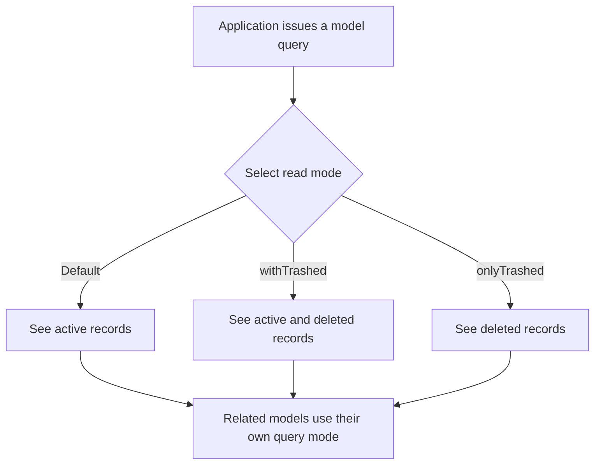
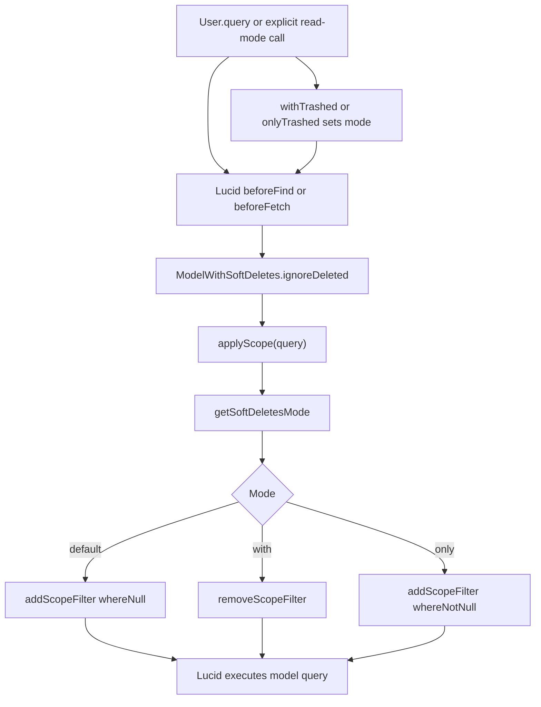

# US-APP-02 — Select active, all, or deleted models

As application code using a `SoftDeletes` model, I want to query active rows or explicitly include deleted rows so that ordinary reads stay clean while recovery workflows can inspect the recycle bin.

**Status:** Current; source-reviewed behavior, not runtime-tested here.
**Access:** Application code. Query scoping does not authorize access.
**Entry:** Model queries, `withTrashed()`, or `onlyTrashed()`.
**Documentation:** [Read modes](../../docs/reference/README.md#read-modes), [query-scope contract](../../docs/reference/scope-contract.md).
**Source:** [SoftDeletes hooks and read modes](../../src/mixin.ts), [scope application](../../src/scope.ts).
**Coverage:** [Scope tests](../../tests/scope.spec.ts), [bypass tests](../../tests/scope_bypass.spec.ts), [relation tests](../../tests/scope_relations.spec.ts).

## Acceptance criteria

- `ModelWithSoftDeletes.ignoreDeleted()` is called by Lucid's `beforeFind` and `beforeFetch` hooks and delegates to `applyScope()`.
- Default mode applies a qualified `whereNull(deletedAtColumn)` filter; `withTrashed()` removes the filter; `onlyTrashed()` applies `whereNotNull(deletedAtColumn)`.
- `ignoreDeletedPaginate()` copies the selected mode to the count query before applying the same scope.
- Each related model query uses its own mode; callers set `withTrashed()` or `onlyTrashed()` in that relation callback when needed.
- Fetch paths that bypass model hooks, including `pojo()`, raw queries and manually joined tables, need explicit predicates; the scope does not filter arbitrary joined or subquery tables.
- A missing mapped `deletedAt` column rejects with `E_MODEL_SOFT_DELETE`.

## User flow

## Code flow

Scope: Lucid model fetch hooks through query predicate construction; POJO, raw and joined-table behavior is outside the hook.

**Code references:** [hooks and read-mode constructors](../../src/mixin.ts), [applyScope](../../src/scope.ts), [scope contract](../../docs/reference/scope-contract.md), [scope bypass tests](../../tests/scope_bypass.spec.ts).
