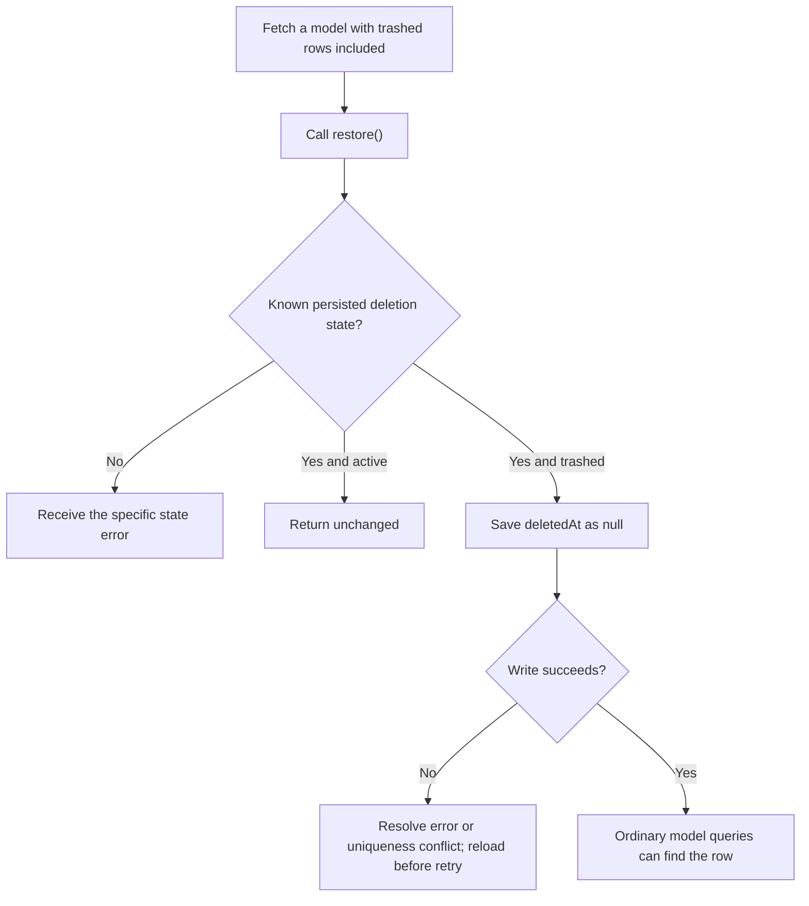
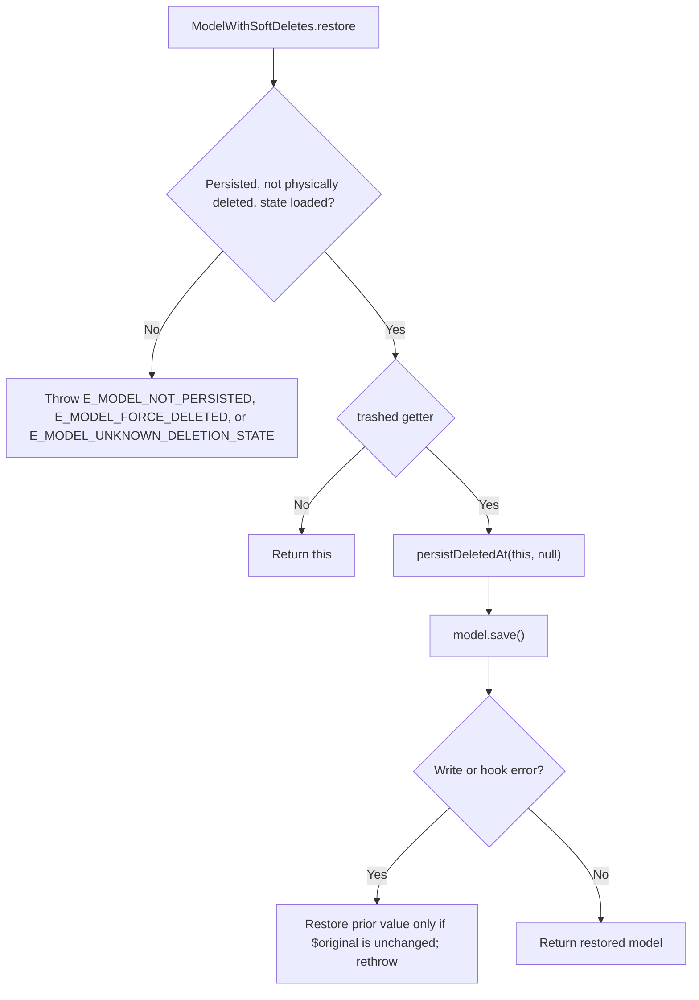

# US-APP-03 — Restore a soft-deleted model

As application code using a `SoftDeletes` model, I want to clear a deleted model's timestamp so that ordinary queries can find it again.

**Status:** Current; source-reviewed behavior, not runtime-tested here.
**Access:** Application code. The host application owns authorization and conflict handling.
**Entry:** Fetch using `withTrashed()` or `onlyTrashed()`, then call instance `restore()`.
**Documentation:** [Instance restore contract](../../docs/reference/README.md#restore).
**Source:** [SoftDeletes.restore](../../src/mixin.ts).
**Coverage:** [Instance lifecycle tests](../../tests/lifecycle.spec.ts).

## Acceptance criteria

- `restore()` requires a persisted model. It rejects with `E_MODEL_NOT_PERSISTED` when unsaved and `E_MODEL_FORCE_DELETED` when Lucid marks the instance physically deleted.
- A persisted non-local model whose loaded attributes omit `deletedAt` is rejected with `E_MODEL_UNKNOWN_DELETION_STATE`; load the column before attempting restoration.
- An active instance is returned without a write. A trashed instance sets `deletedAt` to `null` through `persistDeletedAt()` and normal `save()` hooks.
- On write failure, the error propagates; in-memory restoration depends on Lucid's saved-original state. A caller rollback does not rewind the retained model instance, so discard or refresh it before reuse.
- A unique constraint conflict can prevent restoration when an active row already owns a unique value; resolve the conflict before retrying.

## User flow

## Code flow

Scope: instance restore through Lucid save; outer transaction lifecycle remains caller-owned.

**Code references:** [restore and persistDeletedAt](../../src/mixin.ts), [restore contract](../../docs/reference/README.md#restore), [lifecycle tests](../../tests/lifecycle.spec.ts).
