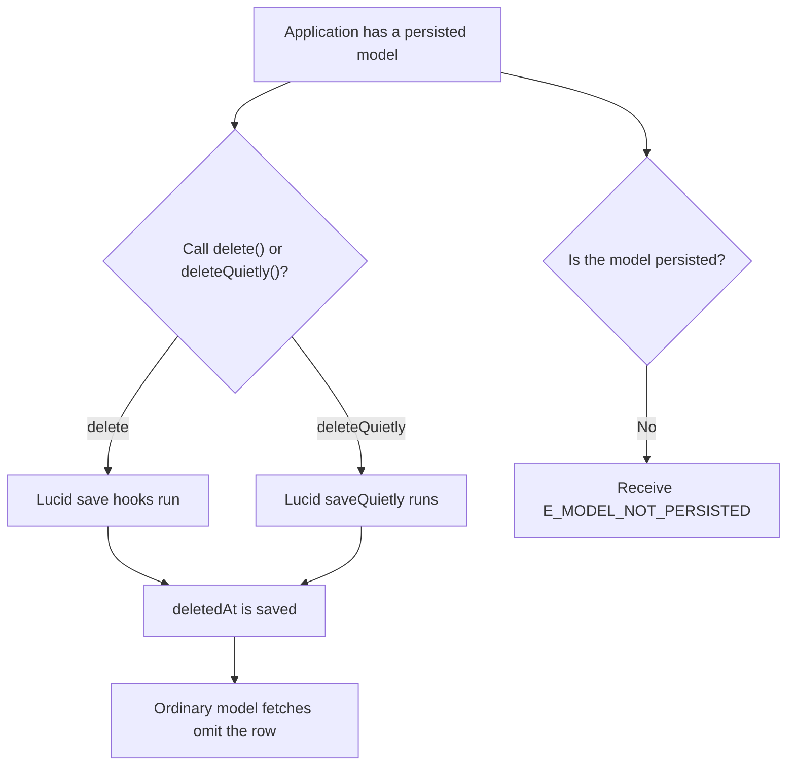
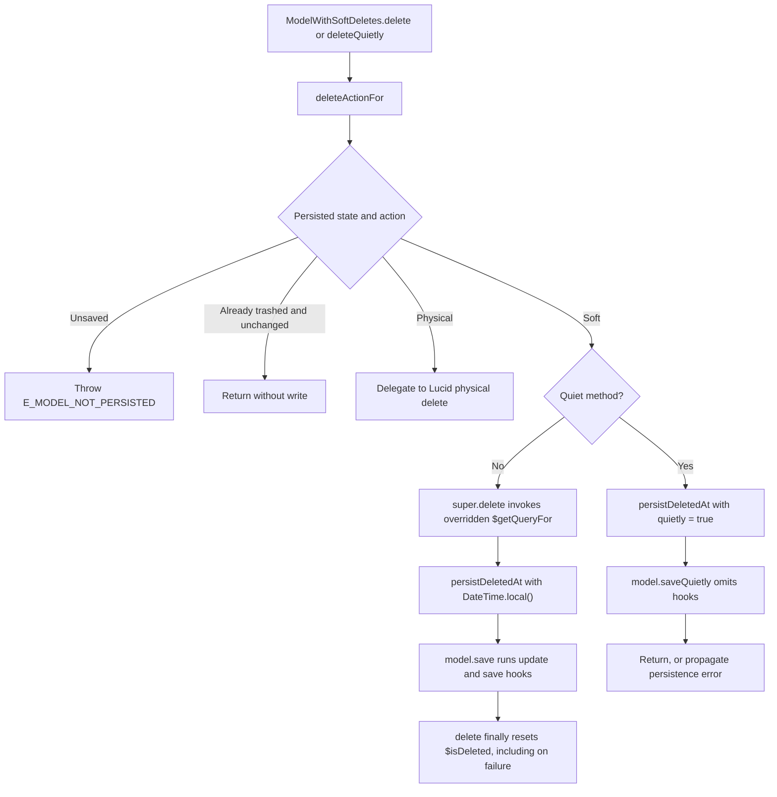

# US-APP-01 — Soft-delete a model instance

As application code using a `SoftDeletes` model, I want to delete a persisted instance so that it disappears from ordinary model queries while remaining recoverable.

**Status:** Current; source-reviewed behavior, not runtime-tested here.
**Access:** Application code. Application authorization is not provided by this package.
**Entry:** Instance `delete()` or `deleteQuietly()`.
**Documentation:** [Instance lifecycle methods](../../docs/reference/README.md#instance-lifecycle-methods).
**Source:** [SoftDeletes mixin](../../src/mixin.ts).
**Coverage:** [Model lifecycle tests](../../tests/model.spec.ts), [quiet deletion tests](../../tests/lifecycle.spec.ts).

## Acceptance criteria

- On a persisted, active instance, `delete()` and `deleteQuietly()` set `deletedAt` to the current local `DateTime`; the former uses Lucid `save()`, the latter `saveQuietly()`.
- `delete()` follows model save hooks; after the call, the row remains stored, `deletedAt` is set, and the instance's `$isDeleted` is reset in `finally`.
- An unsaved instance is rejected with `E_MODEL_NOT_PERSISTED`. A trashed instance without a dirty `deletedAt` is skipped; a force-deleted instance follows Lucid's physical-delete path.
- A write error propagates. `persistDeletedAt` restores the previous in-memory timestamp only when Lucid has not advanced `$original`; an after-save hook can fail after the write completed.

## User flow

## Code flow

Scope: instance call through Lucid save; application route and authorization are outside the package boundary.

**Code references:** [deleteActionFor, persistDeletedAt and instance methods](../../src/mixin.ts), [lifecycle tests](../../tests/lifecycle.spec.ts), [instance API contract](../../docs/reference/README.md#delete).
